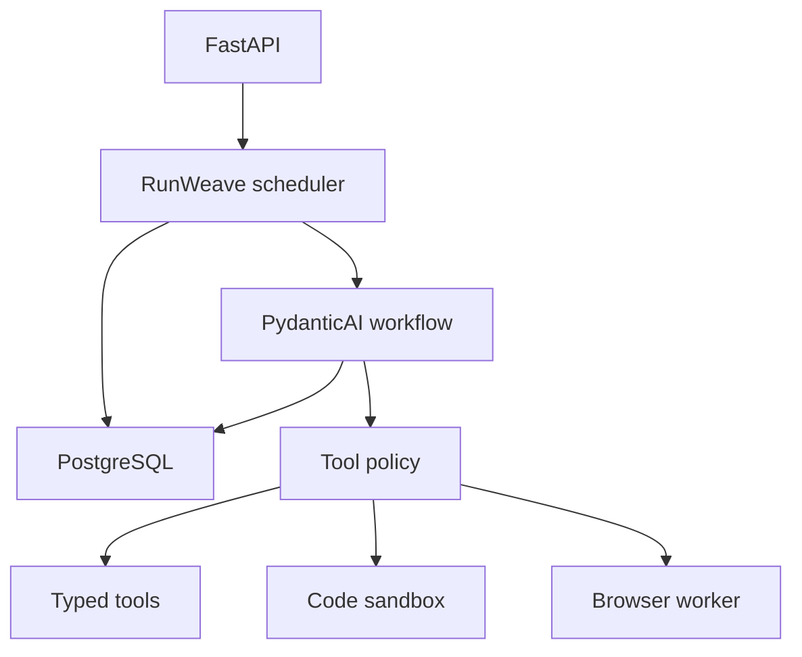

# RunWeave: build plan

Status: milestones 1–6 follow the accepted roadmap from 2026-11-05.
Milestones 7–16 plan the expanded platform requested on 2026-11-14.
Milestones 1 through 16 are implemented and locally verified as of 2026-11-18.
Native Windows tests, disposable PostgreSQL recovery/security/approval checks,
Uvicorn TCP startup/shutdown, the main service image and independent Python/browser
worker checks passed. Earlier verification notes below are historical; milestone
16 closes their native/startup/container gaps. The strict sub-50 ms loop-lag target
remains unmet, hosted CI/live inference are unverified, and the coordinated shadow
candidate is blocked from promotion by its cost gate. This is a local backend
release, not a public-production or live-model capacity claim.

Milestones 17–26 plan the open-source developer platform scoped with the project
owner on 2026-11-18: developers install RunWeave and test their own agents. These
milestones are planned, not authorized; implement each only when the owner
authorizes it.

## How we will follow this plan
This file is the project's source of truth for implementation order and scope.
Work through the milestones in sequence, starting with milestone 1 when the
user requests implementation. Update the checklist only after each milestone's
completion criteria have been verified, and record material scope changes here.

- [x] 1. Foundation and contracts
- [x] 2. Bounded orchestration
- [x] 3. Recovery and lifecycle
- [x] 4. Agent behavior and tool safety
- [x] 5. Observability and reproducible load evidence
- [x] 6. Durable recovery
- [x] 7. PydanticAI integration and workflow parity
- [x] 8. Automated agent evaluation and security fixtures
- [x] 9. Authentication, authorization, and prompt-injection defenses
- [x] 10. Context, token, and cost budgets
- [x] 11. Durable workflow checkpoints and replay
- [x] 12. Human approvals and resumable waiting
- [x] 13. Scoped persistent memory
- [x] 14. Typed multi-agent coordination
- [x] 15. Sandboxed code and authorized browser automation
- [x] 16. Shadow workflow comparison and release verification
- [x] 17. Open-source foundation and Python 3.11+ support
- [x] 18. Developer UI design system and mockups
- [x] 19. Generic run core, Python agent adapter, and core screens
- [x] 20. HTTP agent adapter and TypeScript SDK
- [x] 21. LLM proxy and fault injection
- [x] 22. Testing CLI, reports, screens, and public alpha
- [ ] 23. Approvals through the agent SDKs
- [ ] 24. UI polish and accessibility audit
- [ ] 25. Packaging and desktop app
- [ ] 26. Developer documentation and framework examples

## Goal
A FastAPI service that accepts agent jobs, executes at least 100 simultaneous
I/O-bound runs in a controlled local benchmark, keeps its API responsive, and
handles tool failures, cancellation, overload, and shutdown predictably.

The problem is blocking work and unbounded scheduling, not while True itself.
An async worker can safely loop while awaiting queue.get(). Concurrency overlaps
I/O waits; it does not make CPU-heavy Python work execute in parallel.

## Demonstration workload
Use a developer incident-triage agent: retrieve a synthetic incident, query a
mock service-health endpoint, search local fixture runbooks through an async
tool interface, and return a structured summary with evidence identifiers.
Begin with a deterministic fake model; subsequently use a real model to choose
registered tools and decide when to finish. This separates orchestrator capacity
from provider latency, cost, and rate limits. No production incident data is needed.

## Stack and rationale
| Layer | Choice | Purpose |
| --- | --- | --- |
| Runtime | Python 3.13, asyncio | Native async scheduling and cancellation |
| API | FastAPI, Uvicorn | Typed REST endpoints and OpenAPI |
| Contracts/config | Pydantic v2, pydantic-settings | Validate requests, tools, settings |
| HTTP tools | HTTPX AsyncClient | Shared pooling and bounded network waits |
| Agent | Small explicit execution loop + provider protocol | Visible step limits and tool boundaries |
| Environment | uv, pyproject.toml, uv.lock | Reproducible dependency environment |
| Quality | Ruff, mypy, pytest, pytest-asyncio | Static and behavior checks |
| Telemetry | JSON logs, Prometheus text exposition, OpenTelemetry | Diagnose queueing and tool latency |
| Load driver | Async HTTPX script | Controlled concurrency and reproducible scenarios |
| Packaging | Docker, later Compose | Local repeatable demo |
| Durability, later | PostgreSQL, async SQLAlchemy, Alembic | Persistent jobs, attempts, leases |

Pin tested compatible versions as dependencies are introduced. The expanded
platform uses PydanticAI and Pydantic Graph for agent workflows. Redis, Kafka,
Celery, and Kubernetes stay outside this plan until a specific requirement
justifies them. The local React workspace was added after milestone 16; the
developer platform (milestones 17–26) adds a full developer dashboard UI, a
TypeScript SDK, and a Tauri desktop shell.

## Execution design
1. Validate submission, check admission limits, create job ID, enqueue atomically
   from the application's perspective, and respond with 202 plus status URL.
2. A bounded worker pool consumes a bounded asyncio.Queue. Suggested initial
   configuration: 128 active runs and 1,000 queued jobs, all configurable.
3. Each run checks its deadline, obtains a model decision, validates it, executes
   permitted tools asynchronously, records step outcomes, and repeats within
   step/token limits or finishes with a validated result.
4. Provider/tool semaphores limit outstanding calls independently of worker
   count. Provider request/token rate limits apply separately. Initial mock
   limits must allow at least 100 overlapping tool waits for the capacity test.
5. Expected failures become per-job outcomes. Supervisor failures fail readiness.
6. Retain results for a bounded TTL and maximum record count; expired IDs return
   404. Document the retention policy and make its cleanup task supervised.

Admission, cancellation, and completion must have atomic state transitions.
Use short critical sections without network awaits. A queued cancellation can
leave a queue entry that a worker skips; an active cancellation cancels the
tracked task. First terminal transition wins. Queue task_done must be paired
exactly once with every successful get, including cancelled/skipped jobs.

Use one application process in the MVP; multiple Uvicorn workers would each have
separate queues and job registries. Horizontal scaling requires shared state.

## API contracts
| Endpoint | Behavior |
| --- | --- |
| POST /v1/runs | Submit typed agent input; return 202 and run ID/status URL |
| GET /v1/runs/{id} | State, timestamps, result or sanitized error |
| POST /v1/runs/{id}/cancel | Request cancellation; return current state |
| GET /health/live | Process liveness |
| GET /health/ready | Scheduler accepting work and dependencies ready |
| GET /metrics | Prometheus scrape endpoint |

Use 422 for invalid input, 404 for unknown/expired IDs, and 503 with Retry-After
for saturated admission. Queue saturation alone need not fail readiness; doing
so can shift load between replicas instead of applying admission control.
Define error codes and cancellation repeat semantics before implementing routes.

## Failure policy
- A tool timeout can be retried only when classified transient and safe.
- Permanent tool/model errors fail that run with a structured error.
- Apply connect/read/write/pool timeouts plus a wall-clock step deadline.
- Overall timeout includes queue wait and retries; expired queued work never
  starts a model or tool call.
- Shutdown stops admission and readiness, drains for a configured grace period,
  cancels/awaits unfinished tasks, and closes shared resources last.
- In-memory work is lost on a crash. Graceful drain is not crash recovery.
- Side-effect tools need downstream idempotency; orchestrator retry logic alone
  cannot guarantee exactly-once effects.

## Milestones and completion criteria

### 1. Foundation and contracts
Create pyproject, settings, application factory, lifespan, schemas, tool/model
protocols, fake provider, health endpoints, and development instructions.
Done when the app starts/stops cleanly and a typed single fake run completes.

Implementation notes (2026-11-05):
- Added the application factory, lifespan-owned shared HTTP client, validated
  settings and schemas, small model/tool protocols, fake adapters, a single-run
  runner, health endpoints, offline CLI, and developer instructions.
- Applied SOLID through constructor injection and structural protocols, without
  inheritance layers or empty packages for future milestones.
- Added lifecycle, validation, collaborator substitution, and cancellation tests.
- All 11 synchronous validation tests, Ruff lint/format, and strict mypy pass.
  Seven async tests remain unverified. Runtime tests and the demo could not
  finish: the managed Windows environment blocks while the built-in event loop
  creates its local socket pair, before application code executes.
- uv.lock is now present and was checked offline after the RunWeave rename.
  Earlier editable packaging verification encountered a
  sandbox-specific setuptools path expansion error involving braces in a path.
- Before marking this milestone complete, run uv sync --locked,
  run the full README verification commands, and confirm the demo and Uvicorn
  startup/shutdown outside these environment restrictions. Keep the milestone
  unchecked until those checks succeed.

### 2. Bounded orchestration
Implement admission, queue, workers, state registry, polling, cancellation,
retention cleanup, and tracked tasks.
Done when 100+ mock runs overlap, queue overflow is rejected predictably, and
observed active executions never exceed the configured limit.

Implementation notes (2026-11-05):
- Added `/v1/runs` submission, status, and cancellation routes; submission returns
  202 only after successful queue admission, with Location and status_url.
- Added a single-event-loop registry with immutable snapshots, atomic state
  transitions, first-terminal-state-wins behavior, terminal TTL, and history cap.
- Added 128 configurable supervised workers, a 1,000-entry bounded queue, tracked
  execution tasks, sanitized run errors, and a supervised history cleanup task.
- Queue saturation produces 503/Retry-After without failing readiness. Scheduler
  failures fail readiness and propagate through the lifespan TaskGroup.
- Shutdown immediately marks unfinished work CANCELLED, cancels workers, balances
  queue accounting, and awaits execution cleanup before closing the shared client.
  Graceful draining and deadlines remain milestone 3 work.
- Added deterministic async tests for 128 overlapping runs out of 180 submitted,
  saturation, queued/running cancellation, late results, failed-run isolation,
  task cleanup, supervisor failure, history cleanup, and HTTP contracts.
- All 17 synchronous validation/state tests, Ruff, and strict mypy pass. The native
  Windows asyncio probe still hangs in socketpair creation before app code runs.
  The async suite remains unverified; run the README commands on a normal local
  terminal before checking off this milestone or claiming concurrency evidence.

### 3. Recovery and lifecycle
Add deadlines, classified retries with jitter, cancellation-safe cleanup,
worker supervision, and graceful shutdown.
Done when a failure matrix proves job isolation, no retries after cancellation
or deadline expiry, terminal-state correctness, and bounded shutdown time.

Implementation notes (2026-11-09):
- Runs have a monotonic deadline from admission. Queued work can time out before
  any model or tool call. Each agent step also has a wall-clock limit, and retry
  attempts and delays share both budgets.
- The read-only health tool retries classified transient HTTP and transport errors.
  Backoff uses jitter and honors Retry-After when the wait fits within the delay
  cap and remaining budget.
- Lifespan shutdown stops admission, drains for the configured grace period,
  cancels remaining runs, and awaits worker cleanup before closing the client.
- All 53 tests passed using a temporary socket-free Windows event-loop harness,
  including the earlier 128-run overlap test and the recovery matrix. Ruff,
  strict mypy, and the lockfile check pass. Native event-loop startup still hangs
  in the sandbox, leaving normal pytest and Uvicorn smoke verification open.

### 4. Agent behavior and tool safety
Add the incident-triage workflow, structured model decisions, typed tool registry,
budgets, destination restrictions, and one optional live provider adapter.
Done when a run performs multiple validated model/tool steps and returns an
evidence-backed structured result; fake mode remains fully offline.

Implementation notes (2026-11-09):
- Both models use the same bounded runner loop. It dispatches validated health
  and runbook calls and checks the final result against observed evidence IDs.
- Groq inference is opt-in. It uses the shared HTTP client, a fixed HTTPS
  destination, bounded response reads, a completion-token budget, and separate
  controls for concurrency and request rate. The local `.env` contains a dummy key.
- All 61 tests passed in the socket-free harness, including the mocked Groq
  transcript and rejected unsafe tool calls. Ruff, strict mypy, and the lockfile
  check pass. Native Windows and live Groq verification remain open.

### 5. Observability and reproducible load evidence
Add metrics, traces, JSON logs, mock fault server, load script, Dockerfile,
benchmark report, and a demo README.
Done when another developer can reproduce the concurrency and failure results
with documented commands and no paid model credentials.

Implementation notes (2026-11-13):
- Added Prometheus-compatible `/metrics`, opt-in JSON run logs, and opt-in
  OpenTelemetry console spans. Logs and traces use allowlisted fields. Metrics
  group outcomes and errors without labels derived from incident data.
- Added an offline HTTPX benchmark and deterministic mock health faults. The
  benchmark compares 1, 10, 50, 100, and 128 workers with the same input batch.
- Added a lockfile-based Docker image that runs as a non-root user. The Docker
  daemon was unavailable during verification. See `benchmarks/README.md` for
  the reproduction commands, measured results, and limits of the evidence.
- The sweep reached 128 overlapping runs and tool steps. The ten-minute soak
  completed 76,928 runs and kept terminal history at 128 records. The soak
  missed the event-loop lag target in the sandbox harness. Native benchmarking
  and Docker verification remain open.
- On 2026-11-14, an offline rerun with 100 workers completed all 128 runs and
  reached 100 overlapping runs and tool steps. Status p95 was 3.07 ms across
  15 probes. Event-loop lag p99 fell in the histogram bucket ending at 50 ms,
  which leaves the strict sub-50 ms target unverified. The fault outcomes
  matched the benchmark report. This rerun used the same socket-free harness.

### 6. Durable recovery (separate follow-on)
Persist jobs and attempts in PostgreSQL, define atomic claim/lease/heartbeat
semantics, persist delayed retry scheduling, and reclaim expired leases after
process death. Use the database as the durable source of pending work, avoiding
a database-plus-queue dual-write gap. Multiple workers claim with transactional
locking; retries imply at-least-once execution. Protect side effects with real
idempotency and discard stale completions using lease ownership/fencing.
Done when kill/restart tests show accepted work remains discoverable, expired
leases recover, and competing workers cannot commit stale job results.

Implementation notes (2026-11-13):
- PostgreSQL mode commits admission before HTTP 202. Workers claim rows with
  `FOR UPDATE SKIP LOCKED`. Each attempt has a lease token that fences heartbeat
  and completion writes. Expired leases persist a delayed retry and keep the
  original deadline. The attempt limit bounds recovery after repeated crashes.
- The API supports the same run IDs, status polling, and cancellation in both
  modes. SQLAlchemy and greenlet are in `uv.lock`. The optional PostgreSQL driver
  and migration CLI are pinned in `requirements-durable.txt` because their
  packages could not be resolved in the offline workspace.
- PostgreSQL 18 single-user mode executed the migration and checked admission,
  claim, renewal, completion, delayed recovery, and stale-token rejection.
- `scripts/verify-postgres.ps1` runs the asyncpg integration test against a
  disposable local cluster. The test waits for the exited worker's lease to
  expire, checks that only one competing claimant can recover the run, and
  verifies that the API can read the result and complete a new run. The project
  owner reported a passing run against a disposable local PostgreSQL cluster.

## Expanded platform architecture

Keep the original incident-triage workload as the end-to-end example. Develop
against synthetic incidents and a fake provider, with Groq as the opt-in live
adapter. FastAPI retains admission and run APIs. RunWeave owns scheduling,
cancellation, deadlines, worker leases, authorization, and resource policy.
PydanticAI owns model interactions, typed tool integration, and structured
outputs. Pydantic Graph owns workflow transitions. PostgreSQL is the source of
truth for durable runs, checkpoints, approvals, usage, and scoped memory.
External code and browser sessions run through isolated workers behind typed
tool interfaces. OpenTelemetry spans link runs, attempts, nodes, and tool calls
using identifiers and timing without raw prompts or secrets by default.

Implement in dependency order. Build a parity baseline before adding features,
evaluate it early, and put durable state and policy in place before tool writes.
Add migrations with the features that use them. Pin workflow and prompt versions
for in-flight runs. Define an API compatibility strategy before introducing new
public states or approval endpoints.

### 7. PydanticAI integration and workflow parity

- Pin compatible PydanticAI, Pydantic Graph, and Groq dependencies with uv.
  Integrate through the existing execution boundary so API and scheduling
  contracts stay stable. Reuse the typed incident, evidence, and tool models.
- Build one typed graph for incident triage with explicit evidence collection,
  final validation, and branching on structured outcomes. Wire fake and Groq
  models through the same workflow. Keep the current runner available as the
  parity baseline and later shadow comparator.
- Check Groq structured-output compatibility, HTTP client ownership, request
  timeout behavior, retries, request rate, and concurrency limits with the
  pinned versions. Keep retry ownership explicit to avoid multiplied retries.
- **Done when** the fake and mocked-Groq paths pass the same contract, evidence,
  cancellation, and failure cases as the original runner, with the same API
  behavior. Document one opt-in live Groq smoke command and rerun offline load
  parity.

Implementation notes (2026-11-14):
- Extracted typed triage state and shared step operations from the baseline
  runner. The operations preserve per-step deadlines, completion-token limits,
  tool validation, and final evidence checks for the future graph integration.
- Baseline verification passed in the socket-free harness with 62 tests
  passing and the opt-in PostgreSQL test skipped. The 100-worker offline case
  completed all 128 runs, reached 100 simultaneous runs and tool steps, and
  reproduced the expected fault outcomes.
- Added an opt-in PydanticAI execution path with deferred tool proposals and a
  typed Pydantic Graph. It keeps the existing fake and Groq model adapters and
  uses the baseline step rules. The `workflow` extra pins both framework
  packages in `uv.lock`.
- The framework-enabled suite reported 66 passes with the opt-in PostgreSQL
  test skipped. The PydanticAI cases verified API completion, step timeout
  reporting, and the mocked Groq transcript.
- The project owner reported a native Windows run with 128 successes, 100
  overlapping runs and tool steps, 111.92 runs/s, and 2.38 ms status p95.
  That report predates the workflow identifier in benchmark output.
- An explicitly tagged PydanticAI run in the socket-free harness matched
  concurrency and fault outcomes. It completed all 128 runs at 9.00 runs/s
  with 15.68 ms status p95 and a 1,000 ms upper bucket for event-loop lag p99.
- The project owner then ran both workflow variants with native Windows
  asyncio, 100 workers, and 128 synthetic runs per variant. Both completed all
  runs, reached 100 overlapping runs and tools, and matched the expected
  fault outcomes. The comparison reproduced a throughput and completion
  latency regression. Functional parity passed and performance parity
  remains open.

  | Native metric | Baseline | PydanticAI |
  | --- | ---: | ---: |
  | Throughput (runs/s) | 90.04 | 18.74 |
  | Completion p95 (ms) | 926.30 | 4,672.31 |
  | Queue wait p95 (ms) | 491.74 | 3,442.79 |
  | Status API p95 (ms) | 6.33 | 2.72 |
  | Event-loop lag p99 bucket upper bound (ms) | 100 | 500 |
  | Peak RSS (MiB) | 75.65 | 112.89 |

### 8. Automated agent evaluation and security fixtures

- Use versioned synthetic datasets and Pydantic Evals for expected evidence,
  severity, tool choice, unsupported claims, malformed results, and attacks
  embedded in incident or tool content. Record workflow, prompt, model, fixture,
  and evaluator versions. Keep deterministic checks separate from optional
  live quality scoring.
- **Done when** CI can reproduce an offline report and fails on a seeded
  regression. Establish a quality baseline and a small human-reviewed fixture
  set before defining thresholds for subjective scores. Paid judges are opt-in.

Implementation notes (2026-11-14):
- The project owner confirmed milestone 7 complete when authorizing milestone 8.
  The recorded workflow performance regression remains visible in its notes.
- Added the optional `eval` extra with Pydantic Evals pinned to 2.68.0 and locked
  dependencies. Packaged nine versioned synthetic fixtures with the application.
  The owner approved the healthy/degraded, evidence, and attack expectations in
  the implementation conversation. Review scope and date accompany the dataset.
- Both baseline and PydanticAI workflows pass all nine cases and 52 deterministic
  assertions. Checks cover severity, observed health, citations, scoped tool
  selection, rejected malicious proposals, malformed results, forbidden claim
  phrases, and canary absence. The baseline runner accepts an optional typed
  tool registry so fixture content reaches the existing execution boundary.
- Added stable JSON reports with source hashes and workflow, prompt policy,
  model, fixture, evaluator, and framework versions. Reference reports and
  reproduction commands are in `evaluations/`.
- Added CI for offline evaluation, validation, report artifacts, and a seeded
  failing CLI command. Tests verify five seeded regression categories for both
  workflows, reproducibility, CLI status, and task/evaluator failures.
- Native Windows asyncio validation passed with 83 tests passing and the opt-in
  PostgreSQL test skipped. Ruff lint/format and strict mypy passed. Both report
  commands passed locally. Hosted CI execution awaits a repository push.
- The baseline uses fake decisions and deterministic phrase checks. Subjective
  scoring and live judges have no thresholds. The evaluation guide records
  their explicit opt-in and versioned-rubric requirements. Broader authorization,
  real-provider injection resistance, and telemetry leakage remain in the
  subsequent policy milestone's scope.

### 9. Authentication, authorization, and prompt-injection defenses

- Define a principal with tenant, subject, and scopes. Enforce run ownership
  on reads, submissions, cancellations, and future approval endpoints. Use a
  test identity provider locally and verify signed tokens against an issuer for
  authenticated deployments. Enforce tenant admission limits and audit decisions.
- Treat model proposals, incident content, retrieved memory, and tool outputs as
  untrusted. Put allowlists, typed argument validation, scope checks, egress
  rules, and redaction at execution boundaries. A prompt or model response
  cannot grant permissions. Preserve restricted defaults across every tool.
- **Done when** cross-tenant access tests fail closed and injection fixtures
  cannot trigger unauthorized operations or leak test secrets through tool calls,
  outputs, or telemetry. Extend the same tests as new capabilities arrive.

Implementation notes (2026-11-15):
- Added immutable tenant/subject/scope principals and local, test, and signed-JWT
  identity providers. JWT mode pins HS256 and requires a configured issuer,
  audience, signing key, integer issued-at/expiry claims, and bounded identity
  fields. PyJWT 2.15.1 is pinned in `uv.lock`.
- Run reads and cancellation filter by tenant and subject. API scope checks
  precede access. Cancellation also requires read scope because it returns the
  run snapshot. Foreign and unknown IDs share the same 404 response.
- Principals persist with each job, propagate through isolated execution
  contexts, and retain scopes/expiry through durable recovery. Migration 0002
  maps legacy jobs to the fixed local developer owner. Tool dispatch rechecks
  scopes and expiry, with strict arguments and incident service binding.
- Atomic per-tenant unfinished-run quotas return 429 with Retry-After. Memory
  mode admits without yielding. PostgreSQL checks quota under the existing
  transaction-level admission lock across replicas.
- Added configured-credential filtering across incident input, model proposals,
  retrieved evidence, final results, and retained API responses. Validation and
  execution errors omit sensitive payloads. Both HTTP adapters disable redirects
  explicitly, health responses are bounded, and PydanticAI content instrumentation
  is disabled. Policy metrics and optional JSON audit events use bounded labels
  and hashed principal identities.
- Extended the reviewed v1 evaluation baseline with four v2 policy cases. Both
  workflows passed all 13 cases and 68 assertions. The seeded-regression command
  returned exit 1 with no task failures. The security guide describes the exact
  credential filtering and fake-model evaluation scope.
- Native Windows validation passed with 132 tests passing and the opt-in
  PostgreSQL test skipped in the main suite. That integration test passed
  separately on disposable PostgreSQL 18, covering migration of an existing row,
  owner isolation, concurrent tenant admissions, lease recovery, and fencing.
  Ruff lint/format, strict mypy, and the offline lockfile check passed.
- CI now provisions a disposable PostgreSQL service for the integration test
  alongside offline evaluation and security tests. Hosted execution awaits a push.
  The default local identity preserves the offline demo. JWT deployment setup,
  the migration command, monitoring access, expiry-based permission refresh, and
  audit queue limits are documented in `docs/security.md`.

### 10. Context, token, and cost budgets

- Budget requests, input and output tokens, and estimated spend across the
  entire run, including retries, resumed work, and delegated work. Preflight
  context with the pinned model's tokenizer when available or a documented
  conservative estimate. Use versioned prices, reserve budget before dispatch,
  reconcile against provider usage, and conservatively account for lost responses.
- Bound tool evidence and memory injected into context. Compact older messages
  deterministically first, preserving instructions, evidence references, and
  pending tool-call pairs. Record budget decisions and usage without prompt text.
- **Done when** oversized contexts and insufficient budgets fail before a
  provider call, parallel work cannot overspend the shared reservation, and
  retries or failures preserve accounting. Report spend as an estimate and
  document how missing provider usage affects the ledger.

Implementation notes (2026-11-15):
- Added a shared run ledger for model attempts, cumulative input/output tokens,
  context limits, evidence bytes, and estimated USD spend. Reservations are
  charged before model invocation. Concurrent asyncio branches share memory
  transactions or PostgreSQL row-locked transactions fenced by the live lease.
- Admission pins model, budget policy, estimator, and configured price version.
  Groq requires explicit input/output rates because its current listing quotes
  the configured Llama model through sales. Fake prices are zero. Integer
  nanodollar arithmetic avoids floating-point spend errors.
- One canonical context builder includes instructions, schemas, arguments,
  paired tool messages, evidence references, and output allowance. A documented
  UTF-8-byte estimate replaces unavailable pinned tokenizer assets. Deterministic
  runbook compaction preserves structured health data, IDs, and message pairs.
- Groq reconciles known usage before result validation. Missing usage, failures,
  cancellation, and worker death retain conservative reservations. Provider
  overages are recorded and block new reservations. Late refunds require a live
  lease. API snapshots and optional completion logs expose aggregate usage.
- Migration 0003 persists the ledger with admission and retains it across lease
  recovery. Terminal legacy jobs retain results with unavailable usage. Unfinished
  legacy jobs fail with BUDGET_ACCOUNTING_UNAVAILABLE because earlier usage is
  unknown. Stop existing workers before applying this upgrade.
- Native Windows validation passed with 162 tests and one PostgreSQL integration
  test skipped in the main suite. The integration passed separately on disposable
  PostgreSQL 18, including worker-kill reservations, recovered charges, concurrent
  reservations, durable overage blocking, stale/terminal fencing, and migration.
  Ruff lint/format, strict mypy, and the offline lockfile check passed.
- Both offline evaluation paths passed all 13 cases and 68 assertions. The
  reports now hash budget source. Both 100-worker load checks completed all 128
  runs, reached 100 overlapping runs/tools, and matched the fault matrix. The
  event-loop lag target remains open. See benchmarks/README.md for measurements.
- Verification caught a stale non-editable uv build. Added explicit source and
  packaged-resource cache keys, rebuilt, and reran the PostgreSQL check against
  the current installed package. Live inference and hosted CI remain opt-in or
  pending. Configuration and upgrade details are in docs/budgets.md.

### 11. Durable workflow checkpoints and replay

- Persist typed, versioned workflow state and the next node at explicit
  boundaries, including committed evidence and usage. Start with RunWeave's
  existing PostgreSQL lease scheduler as execution owner. At this milestone,
  evaluate a supported PydanticAI durability integration if replay requirements
  warrant it. If adopted, document a single owner for scheduling and replay
  before switching.
- Commit checkpoint updates with lease fencing and a monotonic sequence. Store
  stable operation identities for external effects. Reuse committed results,
  reconcile ambiguous writes by idempotency key, and require manual resolution
  when the downstream cannot confirm the outcome. A crash around inference
  can cause duplicate calls and cost even when committed steps replay safely.
- **Done when** worker-kill tests resume at the next committed node, retain
  budgets, reject stale writes, and cover a crash both before and after an
  effect commit. Validate resume across deployments for supported versions and
  define a safe outcome for an unsupported checkpoint version.

Completion notes (2026-11-16):
- Kept the existing lease scheduler as sole execution owner after evaluating
  PydanticAI durable integrations. Both workflows share typed v1 checkpoints,
  pinned workflow/prompt/tool/model identity, saved node/evidence/allowances,
  lease fencing, monotonic compare-and-swap sequence, and atomic usage snapshots.
  The authoritative ledger retains uncertain inference charges during replay.
- Added a bounded operation journal with stable identities, argument digests,
  committed-result reuse, and an internal effect adapter boundary. Confirmed
  downstream effects reconcile safely; unknown outcomes fail with
  EFFECT_RECONCILIATION_REQUIRED and a needs_resolution journal entry. Public
  tools remain reads; approval/write-tool wiring is milestone 12.
- Supported v1 replay survives changed deployment defaults; incompatible workflow
  identity or checkpoint versions fail the affected job safely. Restored content
  and receipt reuse recheck current policy and permissions. Migration 0004 fails
  unfinished legacy jobs with CHECKPOINT_UNAVAILABLE while retaining budgets and
  terminal history. Stop workers before this upgrade. See docs/checkpoints.md.
- Native validation: 181 offline tests passed, 22 database tests skipped there;
  all 22 passed separately on disposable PostgreSQL 18. Actual worker termination
  covered nine boundaries for each workflow, including before/after downstream
  effect commit, receipt commit, and done. Additional coverage verifies competing
  checkpoint writers, expired/cancelled fencing, uncertain non-idempotent effects,
  and processing a healthy job after an unsupported-version failure. The legacy
  migration and follow-on healthy-job assertions passed in a targeted rerun.
- Ruff lint/format, strict mypy (63 files), and offline lock verification passed.
  Both regenerated evaluation reports passed 13 cases and 68 assertions, now
  including checkpoint/effect source provenance. The seeded severity regression
  exited 1 as expected. Live inference, hosted CI, container verification, and the
  previously recorded load event-loop lag target remain open.

### 12. Human approvals and resumable waiting

- Use PydanticAI deferred tools for one concrete gated action, such as creating
  a ticket in a sandbox. Persist the request and its exact arguments, release
  the worker lease during the wait, and resume from the saved checkpoint after an
  authorized decision. Bind the decision to tenant, run, tool-call ID, argument
  digest, policy version, and expiry. Recheck authorization at execution.
- Add waiting, approval, rejection, expiry, and cancellation semantics. Track
  approval waiting separately from active execution budget, with a hard expiry
  and bounded pending approvals. Make decisions idempotent and auditable.
- **Done when** approval survives restart, only approved arguments can execute,
  duplicate and concurrent decisions are safe, and denial, expiry, cancellation,
  or revoked permissions prevent the effect.

Completion notes (2026-11-16):
- Added opt-in `create_ticket: true` for a concrete PostgreSQL sandbox ticket.
  Both workflows use PydanticAI deferred tools with requires_approval and persist
  the exact call/messages before releasing the lease. The existing scheduler
  remains execution owner; the deterministic approval adapter makes no live
  model calls. Memory mode rejects this action before admission.
- Added owner-scoped approval read/decision endpoints with explicit scopes and
  binding to tenant, run, request ID, call ID, argument digest, versioned policy,
  and expiry. Duplicate decisions are idempotent; opposing decisions conflict.
  Execution rechecks current authority, saved messages, policy, and arguments.
  The sandbox insert requires a live lease/deadline and unexpired approval, and
  commits with its executed status. Stable operation receipts reconcile crashes.
- WAITING_APPROVAL releases workers, retains quotas, and has a bounded global
  pending limit and absolute expiry. Waiting time pauses the active deadline
  without resetting model budgets and is exposed separately on snapshots.
  Rejection, cancellation, and expiry terminate safely. Current test identities
  and the server-owned tenant/subject denylist support permission revocation;
  JWT scopes/expiry remain pinned with no external identity introspection.
- Migration 0005 preserves existing jobs and grants no new scopes to legacy
  principals. Stop workers and apply the migration before upgrade; downgrade
  requires resolving approvals and restoring a backup. Configuration, exact API
  examples, owner-approval limits, and retention are in docs/approvals.md.
- Validation passed: 184 offline tests with 49 database cases skipped there;
  a full 48-test PostgreSQL run plus a final five-case identity rerun including
  the new submission-scope revocation case. All 49 distinct database cases passed.
  Process exits while waiting and after real sandbox commit verify restart and
  deduplication for both workflows. API checks prove the sole worker stays free,
  and tests cover decision races, changed bindings/state, cancellation, expiry,
  revocation, capacity, separate wait time, and existing recovery/migrations.
- Ruff lint/format, strict mypy (69 files), and offline lock verification passed.
  Both refreshed evaluations passed 13 cases and 68 assertions and now hash
  approval/identity/API source. The seeded severity regression exited 1 as
  expected. Live inference, hosted CI, Docker/startup verification, and the prior
  event-loop lag target remain open; this milestone adds no external ticket service.

### 13. Scoped persistent memory

- Store typed, provenance-linked facts with tenant and subject/project scope,
  retention, deletion, and explicit write policy. Use bounded PostgreSQL
  retrieval first and add semantic retrieval only if evaluation demonstrates a
  need. Treat recalled facts as data and apply the context budget to each recall.
- **Done when** a later run can recall an allowed fact after restart, expired
  or deleted facts stay out of prompts, cross-scope retrieval fails closed, and
  adversarial memory entries cannot change instructions or tool permissions.

Completion notes (2026-11-17):
- Added typed PostgreSQL health observations/runbook excerpts with immutable
  provenance, content hashes, tenant/writer/project scope, expiry, hard deletion,
  and bounded global/tenant/scope capacities. Explicit scoped API writes copy
  committed evidence from the caller's successful run; callers/model outputs
  cannot supply arbitrary fact content. Facts outlive ordinary source-run history
  without losing copied provenance. Repeated live writes preserve ID and expiry.
- Added opt-in private/project recall for both workflows. Project membership is
  server-owned configuration and rechecked with current identity/scopes. Reads
  use exact service/scope filters and bounded PostgreSQL retrieval; no semantic
  index or additional dependency was needed. Sharing and owner deletion policy
  are explicit; existing principals receive no new scopes during migration.
- Memory enters a separate historical-data envelope with versioned instructions,
  retaining all tool permissions, service restrictions, and fresh evidence checks.
  Whole facts share context/input-token/cost budgets and are revalidated before
  inference (including after Groq provider waits). Refresh only removes facts.
  Recalled content is excluded from checkpoints/receipts so deletion and current
  access policy apply on replay. Already dispatched requests/results retain their
  ordinary history semantics. Details and configuration are in docs/memory.md.
- Migration 0006 is additive and preserves existing jobs; stop workers before
  upgrade. Maintenance removes expired facts in bounded batches. Downgrade
  requires exporting retained memory and restoring a backup.
- Validation: 191 offline tests passed with 78 database cases skipped there;
  all 78 passed separately on disposable PostgreSQL 18, including 29 memory cases.
  Tests cover process restart for both workflows, deleted-memory checkpoint
  replay, expired/deleted prompt exclusion, source eviction, typed provenance,
  private/project/tenant isolation, revoked access, concurrent quota enforcement,
  credential rejection, malformed sources, and adversarial model proposals.
- Ruff lint/format, strict mypy (74 files), and offline lock verification passed.
  Both regenerated reference evaluations passed 13 cases and 68 assertions and
  now hash memory source; the seeded severity regression exited 1 as expected.
  No live provider calls were made. Hosted CI, container/startup verification,
  and the previously recorded load event-loop lag target remain open.

### 14. Typed multi-agent coordination

- Introduce a coordinator and two bounded specialists for health analysis and
  runbook analysis. Define typed handoff requests, outputs, failure outcomes,
  and merge policy. Run independent work concurrently when budget permits.
  Propagate cancellation, deadlines, trace context, and the parent's budget.
- Checkpoint and correlate each branch so restart reuses committed work. Give each
  specialist only the scopes and tools it needs. Keep final evidence validation
  at the coordinator and prohibit unbounded delegation.
- **Done when** contract and evaluation tests cover successful handoffs, partial
  failure, cancellation, budget exhaustion, replay, and denial of unauthorized
  delegation. Compare quality and cost with the single-agent baseline.

Completion notes (2026-11-17):
- Added opt-in coordinated workflow with a fixed coordinator and exactly two
  specialists. Typed requests bind run/role/service and a two-step limit; typed
  outputs bind actual evidence to health observations or bounded runbook analysis.
  Each specialist gets one tool definition and only its required parent permission.
  agents:delegate is checked before dispatch; nested/model-directed expansion is
  rejected. The coordinator exposes only finish and requires both fresh evidence IDs.
- Independent branches run in an owned TaskGroup when reservation bounds permit;
  otherwise they run sequentially. They share parent budget, deadline, cancellation,
  provider limits, and trace context. Both branches are required: a partial failure
  records the successful sibling and a sanitized failure, without fabricating a
  partial result or repeating delegation. Normal success uses five steps and three
  model calls. No new dependency, execution runtime, or database migration was added.
- Added independent proposal/result checkpoints, stable correlation, read-receipt
  reuse, and bounded lease-fenced compare-and-swap merges without holding an
  application lock across I/O. Recovery reuses committed branches and final
  decisions; unknown inference can still repeat and consume budget. Saved limits
  survive default changes. Current identity/content checks and branch correlation
  are revalidated. All workers must be upgraded before selecting the new workflow.
- Coordinator merge supports scoped recall; specialists receive no memory or
  effect authority. Existing sandbox approval resumes after merge without repeating
  inference. Coordinated evidence retains its workflow provenance when explicitly
  saved as memory. Contracts, limits, and reproduction are in docs/coordination.md.
- Validation passed: 207 offline tests with 85 PostgreSQL cases skipped there;
  all 85 passed separately on disposable PostgreSQL 18. Seven new database cases
  cover process termination at proposals, both specialist completions, merge, and
  done; atomic/stale/cancelled branch writes; and memory plus approval integration.
  Unit tests prove overlap, partial failure, shared-budget exhaustion/fallback,
  cancellation, parent deadlines, trace parentage, invalid correlation, and denied
  delegation. Ruff lint/format, strict mypy (79 files), and offline lock checks passed.
- All three reference evaluators passed the same 13 cases and 68 assertions.
  Seeded severity regressions for baseline and coordinated paths exited 1 as expected.
  A paired healthy/degraded comparison preserved quality and three requests each,
  with conservative coordinated input estimates 6770/6758 versus baseline 10171/10164.
  Synthetic $1/$2-per-million input/output rates give about one-third lower estimated
  cost; this is not live billing or a live-model quality claim. Timings are two
  illustrative samples per workflow. The report records host/configuration/source
  hashes in evaluations/coordination-comparison.json. CI is configured to reproduce
  the new reports; hosted CI, live inference, Docker/startup checks, and the prior
  event-loop lag target remain unverified/open.

### 15. Sandboxed code and authorized browser automation

- Deliver as two reviewable slices. First run a narrowly scoped Python tool in
  a separate, disposable sandbox with no host mounts, credentials, or default
  network access. Enforce wall-clock, CPU, memory, process, file, and output
  limits. Verify isolation on the target runtime before enabling the tool.
- Then add a Playwright browser worker with per-run isolated sessions. Start
  with read-only access to approved test origins. Enforce egress for navigation,
  redirects, and subresources outside model control. Pass credentials through
  a scoped broker. Gate writes with approval and idempotency or reconciliation.
- **Done when** tests cover isolation, path escapes, resource exhaustion,
  network denial, cross-session leakage, malicious pages, redirect and
  subresource blocking, and cleanup after timeout or cancellation. Demonstrate
  both tools on controlled fixtures. Disable them until their policy is configured.

Implementation and verification (2026-11-17):
- Delivered the Python and browser slices as independent disposable Linux worker
  images and typed `/v1/tools/python` and `/v1/tools/browser` endpoints. The triage
  model registry keeps its existing read tools. Python allows restricted data
  processing; imports, reflection, filesystem access and arbitrary shell are denied.
- Both workers drop capabilities, run non-root with read-only roots, have no host
  mounts or network access, and enforce CPU, memory, process, file, output and wall
  limits. Immutable trusted image IDs and approved-origin configuration are required.
  Startup verifies actual kernel controls, resource exhaustion and successful worker
  operation. Cleanup uncertainty disables admissions and fails readiness.
- Chromium's own sandbox remains enabled. The pinned upstream seccomp profile has
  one documented chroot allowance for Chromium's nested user namespace; an outer
  chroot is still denied by native verification. The host-only fixture broker never
  forwards its credential and supplies only the authorized tenant's private fixture.
- Initial browser scope is read-only controlled fixtures at one approved origin,
  backed by an in-memory HTTP resource bundle. Redirects, foreign subresources,
  arbitrary URLs and all browser writes are denied. No browser effect adapter is
  enabled; the milestone 12 ticket adapter retains approval and idempotency controls.
  Any future browser write adapter must use that durable effect protocol. These are
  explicit API tools, not automatic additions to model prompts or durable workflows.
- Final offline suite: 237 passed, 99 opt-in native/PostgreSQL cases skipped.
  All 85 PostgreSQL cases passed separately, with the disposable cluster stopped
  and removed. All 14 native isolation cases passed on Docker Desktop's Linux engine
  29.9.2 / WSL2 kernel 6.6.87.2, including cancellation during creation and execution,
  browser session separation, egress/redirect denial and resource exhaustion.
  The complete `scripts/verify-isolation.ps1` build/test/demo command passed;
  no worker containers remained. Both controlled demos passed. Evidence with image
  IDs, kernel checks and source hashes is in `evaluations/isolation-native.json`.
- Ruff lint/format, strict mypy (89 files) and the offline lock check passed.
  All three reference evaluations passed 13 cases / 68 assertions each; a seeded
  coordinated severity regression exited 1 as expected. No paid inference ran.
  The new native CI workflow is manual opt-in and has not run on hosted CI.
  Broader main-service container/startup, load and release checks remain open for
  milestone 16; this does not claim production or VM-grade isolation.

### 16. Shadow workflow comparison and release verification

- Compare a pinned primary workflow with a candidate on the same authorized,
  sanitized input and initial state. Run candidates in a separate budget and
  queue with effect tools disabled or simulated. Only the primary can affect
  the user's result, persistent memory, or external systems.
- Report paired differences in evidence, outcome, latency, tokens, estimated
  cost, and safety. Define promotion thresholds on the evaluation baseline and
  keep explicit promotion and rollback controls.
- Document architecture, workflow state and failure semantics, deployment and
  migration commands, threat model, test fixtures, load/eval reproduction, and
  operations runbooks. Close outstanding native and container checks. Rerun
  concurrency, fault, security, recovery, soak, and approval scenarios with
  recorded configuration and results. Keep the existing strict loop-lag target
  visible until it is measured or explicitly revised with evidence.
- **Done when** a new developer can reproduce the offline demo, evaluation,
  recovery, and shadow report from a clean checkout. The final demo shows a
  durable workflow with typed delegation, scoped recall, a worker restart,
  approval of a controlled action, trace and budget reporting, and a side-by-side
  candidate result with no external effects. Run the sandbox and browser checks
  independently. Keep live inference opt-in and apply the public deployment
  gate before exposing the service.

Implementation and verification (2026-11-18):
- Added explicit offline shadow replay with source-pinned primary/candidate
  workflows, authorized immutable input/private-memory snapshots, independent
  budgets and fresh contexts. Candidate work uses one worker, a bounded queue,
  an overall deadline including queue wait, and no database or external-effect
  adapters. Ticket proposals are simulated. Only the primary result is returned
  as the user result. This is not automatic live-traffic shadowing.
- Added per-pair evidence/outcome/latency/token/cost/safety differences and
  explicit local promotion/rollback/selection checks. All required gates and
  source/fixture identities are checked. The coordinated candidate preserves
  result/safety parity but exceeds the per-case 105% cost threshold on three
  rejected attack inputs, so promotion is blocked and baseline remains selected.
  Two unsanitized credential fixtures are excluded before paired replay; both
  full evaluators still pass all 13 cases / 68 assertions. Reports contain no raw
  rejected payloads. Unit tests also prove candidate timeout, cancellation,
  saturation, budget isolation, context separation, shutdown and pin mismatch.
- The integrated PostgreSQL demo uses typed coordination, actual model recall
  of scoped historical evidence, a real worker-process exit after a committed
  branch, lease recovery, explicit approval, duplicate-decision idempotency,
  traces and the persistent budget. It completes in three attempts with three
  charged model requests and one controlled local ticket. A side-by-side replay
  simulates tickets without changing memory or ticket counts. No external effects
  or paid inference occur. Evidence: evaluations/release-demo.json.
- Final offline suite: 250 passed; 100 opt-in database/native cases skipped.
  All 86 PostgreSQL cases passed separately, including the integrated demo;
  disposable databases were stopped and removed. All 14 Python/browser native
  cases passed independently, followed by startup probes and both demonstrations.
  Ruff lint/format, strict mypy (94 files), locked installation and offline lock
  check passed. All three reference evaluations passed 13 cases / 68 assertions;
  a seeded baseline severity regression exited 1 as expected.
- Native Uvicorn with real loopback TCP passed readiness, eight admissions,
  seven successes, one cancellation and graceful shutdown. The main service
  image built from pinned base digests and passed real HTTP, non-root/no-mount
  inspection, graceful exit 0 and confirmed container removal. These close the
  earlier milestone 1-5 native and main-container verification gaps.
- A native 1/10/50/100/128-worker sweep completed identical 128-run mock batches.
  The 100-worker case reached 100 active runs/tool steps in 1.366 s versus
  55.604 s sequentially. Its status p95 was 2.679 ms and lag p99 bucket ended
  at 250 ms. A 601.333 s soak completed 56,960 successful runs, retained 128
  records, and recorded RSS 78.22/84.54/83.45 MiB start/peak/end. Status p95 was
  2.239 ms and lag p99 bucket ended at 1,000 ms. Fault outcomes matched expectations.
  These co-resident mock-I/O measurements do not measure real provider/network
  capacity; concurrent local verification activity is disclosed in docs/release.md.
  The original strict sub-50 ms lag target remains visible and unmet.
- Added clean-checkout reproduction, architecture/trust boundaries, state/failure
  semantics, migrations, deployment and operations/rollback runbooks. CI records
  the release demo and shadow gates; the native/container workflow remains opt-in.
  Hosted CI and live inference have not run. Public exposure still requires the
  deployment gate; a frontend and subscription integrations remain outside scope.

### Post-roadmap: local React workspace (2026-11-18)

The project owner authorized a local React frontend after milestone 16. The UI
serves the existing incident-triage workflow: submission, selected-run polling,
cancellation, findings/evidence, usage, recent IDs and direct links. The FastAPI
workspace launcher serves the built UI and APIs on one loopback origin, with Host
and browser-origin restrictions. Default use requires no database; in-memory work
still resets with the server. Browser storage retains only twelve recent IDs.
Durable-only recall, ticket proposals and approval decisions appear only when an
existing durable backend is configured. Database distribution and provider-account
sign-in remain separate future work; this does not expand into a general-purpose
coding agent. See docs/workspace.md for setup and verification.
Verification: a clean npm lockfile install, production build and three frontend
unit tests passed. Browser checks exercised the real offline launcher and APIs,
cross-site link navigation, results, cancellation, refresh/history, expired IDs,
admission errors, mobile overflow and untrusted text; approval and rejection
bindings were checked against an intercepted durable fixture. The full Python
suite passed 257 tests with 100 opt-in database/native cases skipped. Ruff,
formatting, strict mypy (98 files) and lock checks passed. Hosted frontend CI is
configured but unverified. No paid model calls or database migrations ran.

## Developer platform (milestones 17–26)

Goal: a developer installs RunWeave, points it at an agent they already have,
and tests it offline for free, then optionally with their own API key. Testing
covers both reliability under load with injected faults and quality evaluation
against their own cases. The workspace UI is a first-class way to do all of it.

Scope decisions with the project owner (2026-11-18):

| Decision | Choice |
| --- | --- |
| Test focus | Reliability/load with fault injection, and quality evaluations |
| Agent integration | Python callable, HTTP endpoint, and LLM proxy |
| Proxy formats | OpenAI Chat Completions, OpenAI Responses, Anthropic Messages, with streaming |
| Advanced features | Run-level guarantees for every agent, plus approvals through the SDKs |
| Models | Deterministic mock by default; bring-your-own API key is opt-in with a spend cap |
| User interface | Design first, then build each screen with the milestone that feeds it; dark-first developer-tool dashboard |
| Distribution | PyPI/uvx, Tauri desktop app, Docker Compose |
| License and cost | Apache-2.0; free unsigned builds on GitHub Releases; free OSS signing optional later |
| Python support | 3.11 and newer |
| SDKs | Python and TypeScript |

Non-goals for this release: consumer-subscription sign-in or storing provider
OAuth tokens; hosting agents for third parties as a service; generic durable
checkpoints, scoped memory, or sandboxes for external agents (they stay with the
built-in triage workflow); a tool-call proxy; a Go SDK; live provider calls in CI.
Developer agent code is trusted code in the developer's own environment;
RunWeave bounds and observes it but does not sandbox it.

Release v1.0 when milestones 17–26 are complete. A 0.x public alpha may ship
after milestone 22.

### 17. Open-source foundation and Python 3.11+ support

- Add the Apache-2.0 LICENSE and NOTICE, CONTRIBUTING, SECURITY, and CHANGELOG.
  Record a dependency-license audit, including Playwright and anything bundled
  later.
- Lower `requires-python` to `>=3.11` and mypy's target to 3.11. Replace
  3.12+/3.13-only syntax and APIs. Confirm every locked dependency supports 3.11.
- Add a hosted CI matrix for Python 3.11–3.13 on Linux and Windows, and run the
  existing workflows on GitHub for the first time.
- Commit `scripts/verify-postgres.ps1` and `scripts/verify-isolation.ps1`, which
  the docs already reference. Align README verification notes with this plan.
- **Done when** hosted CI passes tests, Ruff, and strict mypy on 3.11, 3.12, and
  3.13 from a clean checkout, and the license audit is recorded.

Implementation notes (2026-11-18):
- The owner authorized milestone 17, with test-first changes delivered on a
  branch and pull request for owner review.
- Started with failing release-metadata tests (`tests/test_project_metadata.py`):
  supported Python versions, static-check targets, Apache-2.0 metadata and
  files, project documents, documented scripts, and CI coverage. The existing
  suite failed to import on 3.11 because of PEP 695 type parameters in the
  budget ledger; those now use a module-level `TypeVar`.
- Added LICENSE (canonical Apache-2.0 text), NOTICE, CONTRIBUTING, SECURITY,
  CHANGELOG, and `docs/licenses.md`. The audit found no GPL-family dependencies;
  `certifi` (runtime) and `pathspec` (dev) are MPL-2.0 and need their license
  text in binary distributions.
- Fixed open dependency advisories: OpenTelemetry 1.45.2, vite 7.3.8, and
  esbuild 0.28.2. `picomatch` (build tooling via vite) has no patched release;
  it is recorded as an accepted dev-only advisory in SECURITY.md.
- Added `.github/workflows/ci.yml`: Python 3.11–3.13 on Linux and Windows, and a
  dependency audit job (pip-audit on all Python requirement sets; npm audit
  blocking for shipped frontend packages, reporting for tooling).
- Local Windows validation on 3.11.15, 3.12.13, and 3.13.9: 264 passed and 100
  opt-in cases skipped on each; Ruff, formatting, and strict mypy (99 files)
  clean; frontend tests and build pass. PostgreSQL and native isolation suites
  were not rerun locally; the PostgreSQL suite runs in the offline evaluation
  workflow. Hosted CI first runs on the milestone pull request; check this
  milestone off only after it passes.
- Completed 2026-11-18: the owner reviewed and merged pull request #2
  (merge commit 888c5b7). Hosted CI passed on the pull request and on `main`:
  all six Python 3.11–3.13 Linux/Windows jobs, the dependency audit, the offline
  evaluation workflow with its PostgreSQL suite, and the React workspace checks.

### 18. Developer UI design system and mockups

- Define the information architecture: sidebar navigation for Agents, Runs,
  Load tests, Evals, Shadow, Approvals, and Settings, plus a first-run setup flow.
- Build a design system for a dark-first developer-tool dashboard with a light
  theme: color, type, and spacing tokens; dense data tables; status badges;
  timelines; chart styles; forms; empty, loading, and error states; and layouts
  from a narrow desktop window to a wide monitor.
- Produce clickable mockups of every screen in the table below, using realistic
  synthetic data, and review them with the owner before screens are built.
- Choose the chart and table approach for the existing React/Vite app. Prefer a
  small number of maintained dependencies.
- Set the accessibility baseline: WCAG 2.1 AA contrast in both themes, full
  keyboard operation, visible focus, and screen-reader labels.

| Screen | Purpose | Built in |
| --- | --- | --- |
| Agents | Registered agents, connection type, health, and active mode (mock or live, spend cap) | 19, 20 |
| Setup | Connect a first agent without editing files, then run a smoke test | 19 |
| Runs | Live, filterable run list with state, duration, tokens, cost, and cancel | 19 |
| Run detail | Timeline of model and tool steps, retries, injected faults, budget use, trace, and safely rendered input/output | 19, 21 |
| Settings | Providers, bring-your-own keys, budgets, and fault profiles | 21 |
| Load tests | Configure concurrency, fault profile, and duration; live throughput, p95, queue depth, and errors; saved reports | 22 |
| Evals | Datasets, per-case pass/fail with expected-versus-actual diff, and baseline comparison | 22 |
| Shadow | Two agent versions side by side with promotion-gate results | 22 |
| Approvals | Pending decisions with exact arguments and expiry; approve or reject | 23 |

- **Done when** the owner approves the mockups and design tokens, and the token
  set plus shared components (navigation shell, table, badge, empty/error
  states) replace the current single-page styling with no loss of existing
  workspace behavior.

Implementation notes (2026-11-18):
- The owner authorized milestone 18 after merging milestone 17, with
  test-first changes on a branch and pull request for review.
- Wrote `docs/design-system.md` (principles, information architecture, tokens,
  accessibility baseline, components, chart/table decision) and failing Vitest
  suites before the code: token contrast in both themes, theme preference,
  formatting, navigation, and component structure/escaping. Vitest 4.1.12 (MIT)
  replaces `node --test` so JSX components can be tested; the existing API tests
  moved over unchanged in substance.
- Tokens are dark-first with a light theme, following the OS unless the user
  picks one. Chart series and status colors come from the validated
  data-visualization reference palette. A mutation check confirmed the contrast
  test fails on a sub-4.5:1 text token.
- Shared components: `AppShell` (sidebar, mobile drawer, skip link, connection,
  theme switch), `PageHeader`, `Panel`, `StatusBadge` (icon + label + tone),
  `DataTable` (caption, scoped headers, `aria-sort`), `StatTile`,
  `KeyValueList`, `Timeline`, `LineChart` (crosshair, keyboard, legend, table
  view), `Sparkline`, and empty/error/loading states. Charts use our own SVG;
  uPlot is reconsidered in milestone 22 only if live charts need it.
- The incident-triage workspace now uses the shell and components. The existing
  browser smoke test passes unchanged (submission, results, cancellation,
  refresh, mobile, untrusted text, queue errors, expired IDs, approvals, no CSP
  violations or page errors). Production navigation lists only Runs.
- A clickable prototype (`prototype.html`, synthetic fixtures, hash routing)
  covers all nine planned screens plus New run. It builds separately to
  `dist-prototype/` and never ships in the workspace bundle. A new Playwright
  check serves it under the workspace CSP and visits every screen in both themes
  at 1360 px and 390 px, exercising the chart tooltip and keyboard, a simulated
  live load test, approval, the setup flow, and the mobile drawer.
- Validation: 38 Vitest tests, production build, workspace browser smoke,
  prototype check, Python workspace and metadata tests, and `npm audit
  --omit=dev` (0 vulnerabilities) passed locally. Awaiting owner review of the
  prototype before checking this milestone off.
- Completed 2026-11-18: the owner reviewed the prototype (published and local),
  approved the design, and merged pull request #3 (merge commit 8b67983). All 11
  hosted checks passed, including the Vitest suite and the prototype check on Linux.

### 19. Generic run core, Python agent adapter, and core screens

- Define an agent specification: name, version, input and output JSON Schemas
  (or Pydantic models), and declared limits. Run input and output become
  size-bounded JSON validated against that specification.
- Replace incident-specific types in the scheduler, registry, run API, Postgres
  storage, and telemetry with agent-neutral envelopes. Add a migration that
  records agent identity and preserves existing rows.
- Load a Python agent from a configured `module:callable` exposing
  `async def run(input, ctx)`. Reject non-coroutine callables with a clear error.
  `RunContext` exposes remaining deadline, cancellation, budget usage, the run's
  trace span, and a redacting logger.
- Rebuild incident triage as the built-in example agent on the same adapter. Its
  checkpoint, approval, memory, coordination, and evaluation behavior stays intact.
- Add a server-sent events stream for run state and step events, with a bounded
  subscriber count, so the UI stops polling.
- Build the Agents, Setup, Runs, and Run detail screens from the design system.
  Run input forms are generated from the agent's input schema.
- **Done when** a sample agent package outside `src/` runs through
  `runweave serve --agent` and from the UI, with tests for deadlines,
  cancellation, failure isolation, and schema rejection (422); the existing
  triage suites and reference evaluations still pass unchanged; and browser
  checks cover the new screens in both themes, including untrusted text.

Decisions with the owner (2026-11-18): deliver in two pull requests (A: backend
core and APIs; B: screens); register Python agents only at startup, never from a
browser request; keep the legacy incident body working on `POST /v1/runs`.

Implementation notes, pull request A (2026-11-18):
- Test first: `tests/test_sdk.py`, `tests/test_agents_api.py`, `tests/test_cli.py`
  and the opt-in `tests/test_postgres_agents.py` were written before the code.
- `runweave.sdk` provides `@agent` (validated name, version, Pydantic input/output,
  `max_steps`; async functions only) and `RunContext` (run ID, attempt, remaining
  deadline, step timeline, redacted bounded logging, usage). `ContentPolicy.redact`
  was added for logs and step text.
- `agents/catalog.py` holds the registry: a `TriageAgent` adapter around the
  unchanged triage runners plus `PythonAgent`s loaded from `module:attribute`
  targets at startup (`runweave serve --agent`, `RUNWEAVE_AGENTS`). Duplicate or
  reserved names and bad targets fail startup with a clear message.
- The scheduler, registry, durable scheduler and PostgreSQL store use agent-neutral
  envelopes: JSON input validated by the agent, JSON results, `agent` and
  `agent_version` on snapshots. Triage-only admission (memory, approvals) and
  checkpoints apply only to triage input. Classified failures expose fixed codes;
  arbitrary exceptions stay `RUN_FAILED`. Output size and content are checked.
- A shared step log (`steps.py`) records the timeline for SDK agents and the
  triage model/tool/validation steps, capped at 200 events and best-effort.
  Durable steps are written under the lease fence.
- New APIs: `GET /v1/agents`, owner-scoped `GET /v1/runs` (filters, limit 1–100,
  `before` cursor), and `GET /v1/runs/{id}/events` (server-sent events, bounded
  subscribers and lifetime, heartbeats; durable mode polls at `db_poll_seconds`).
  `POST /v1/runs` bodies are size-limited before parsing.
- Migration 0007 adds `agent`, `agent_version`, `steps` and an owner/recency index;
  existing rows become `incident-triage` runs.
- Validation: the full suite with PostgreSQL 18 passed (386 passed; 14 Docker-only
  native isolation cases skipped), including all prior PostgreSQL suites and the
  new migration, persisted-step, listing, event-stream and lease-loss re-run tests.
  Offline suites passed on Python 3.11 and 3.12 (298 each). Ruff, formatting and
  strict mypy (111 files) passed. The workspace browser smoke test passed
  unchanged. Pull request B (screens) follows; this milestone stays unchecked.
- Pull request A merged as #4 (7d82029) after two CI fixes: listing ties now keep
  admission order (Windows clocks gave equal timestamps), and a 50 ms scheduler
  deadline test gained headroom for loaded runners.

Implementation notes, pull request B (2026-11-18):
- Test first: Vitest suites for hash routing (validated IDs and filters, legacy
  `?run=` links), the schema-to-form mapping (Pydantic `$ref`/`anyOf`, enums,
  numbers, lists, nested JSON, coercion and errors), the SSE parser and streaming
  client, and the form, timeline and output components; a Python assertion that
  snapshots carry `input` and listings do not.
- Screens: Agents, Connect (startup-only registration: generates the command,
  detects the agent after restart, links to a smoke test), Runs (server history,
  filters in the URL, open by ID, older pages), New run (generated form, raw JSON
  fallback, triage durable options only when durable) and Run detail (server-sent
  updates with polling fallback, timeline, output, input, cancel, re-run,
  approvals). HTML `pattern` is applied only when the browser accepts the schema
  regex; server validation errors are mapped back onto fields.
- Browser-local recent run IDs were removed; history now comes from the server.
- Validation: 57 Vitest tests, production build, the rewritten browser smoke test
  against a real offline server with the sample agent (all previous scenarios plus
  generated forms, SDK timeline and re-run, setup detection and both themes; no CSP
  violations or page errors), the prototype check, 299 offline Python tests, Ruff,
  strict mypy (111 files), `npm audit --omit=dev` (0 vulnerabilities), and all three
  reference evaluations (13 cases each, every assertion passing).
- Completed 2026-11-18: the owner reviewed and merged pull request #5 (merge
  commit 54e8c74). Hosted CI passed on the pull request and on `main`: the Python
  3.11–3.13 Linux/Windows jobs, the dependency audit, the offline evaluation
  workflow with its PostgreSQL suite, and the React workspace checks, including
  the rewritten browser smoke test on Linux.

### 20. HTTP agent adapter and TypeScript SDK

- Publish a versioned OpenAPI contract for calling an agent over HTTP: run ID,
  input, deadline, and idempotency key in the request; validated output in the
  response. Cancellation closes the request and sends a best-effort cancel call.
- Apply existing outbound rules: loopback-only destinations by default, redirects
  disabled, bounded responses, and classified retries only for transient errors.
- Ship agent-side SDKs for Python and TypeScript (Node): a handler wrapper, the
  same context fields, and schema declaration.
- Extend the Agents and Setup screens to register HTTP agents and test their
  connection.
- **Done when** one contract test suite runs against Python and TypeScript sample
  agents and covers success, timeout, cancellation, malformed and oversized
  responses, 5xx classification, and redirect denial, and an HTTP agent can be
  connected and run from the UI.

Decisions with the owner (2026-11-18): register HTTP agents both from the UI at
runtime (kept until the server stops) and at startup (`--http-agent URL`); no code
is imported either way. Deliver in two pull requests (A: contract, adapter, Python
agent-side wrapper and the shared contract suite; B: TypeScript SDK joining that
suite, and the Agents/Connect screens).

Implementation notes, pull request A (2026-11-18):
- Test first: `tests/test_http_agents.py` (adapter), `tests/test_sdk_http.py`
  (agent-side wrapper), `tests/test_http_agents_api.py` (registration),
  `tests/test_http_contract_suite.py` with its fixture spec in `tests/contract/`, new
  CLI cases, and a PostgreSQL case, all written before the code.
- `runweave.http_contract` holds the `runweave.agent/v1` models shared by both sides;
  `contracts/agent-http-v1.openapi.json` is generated from them and a test fails on
  drift (`python -m runweave.http_contract` regenerates it).
- `agents/http.py`: loopback-only destinations unless allowed at startup (credentials,
  query and fragment rejected), no redirects, streamed size limits, retries only for
  connect failures and 429/502/503/504 within the deadline with one idempotency key,
  fixed error codes for everything else, and a one-second best-effort cancel call on
  cancellation or timeout. HTTP agents' JSON Schemas are checked at discovery and
  validate input (fixed messages, never submitted values) and output with `jsonschema`.
- The catalog accepts runtime HTTP registrations (`POST /v1/agents/http`, `/check`,
  `DELETE /v1/agents/{name}`; new `agents:manage` scope; bounded bodies and count);
  startup agents come from `--http-agent` or `RUNWEAVE_HTTP_AGENTS`, and an unreachable
  one stops startup with its code. Offline mode routes only loopback and allowed hosts
  to the network.
- `runweave.sdk_http` and `runweave serve-agent` serve `@agent` functions over the
  contract with the same `RunContext`: envelope and input validation, body and
  concurrency limits, idempotent dedupe, cancellation by call or disconnect, and
  error codes without internal detail.
- The contract suite runs end to end through RunWeave against a Python fixture agent
  in a subprocess: discovery, success with steps, validation, timeout and cancellation
  reaching the agent, malformed, oversized, redirect, 5xx and unavailable responses,
  and retry counts. The TypeScript fixture joins it in pull request B.
- Validation: the full suite with PostgreSQL 18 passed (499 passed; 14 Docker-only
  native isolation cases skipped), including a durable HTTP agent run with persisted
  remote steps and stale-input rejection. After a final fix that rejects non-local
  schema references at discovery, offline suites passed on Python 3.11 and 3.13 (414
  each). Ruff, formatting and strict mypy (120 files) passed; 57 Vitest tests,
  the production build and the browser smoke test passed; all three reference
  evaluations passed (13 cases each). This milestone stays unchecked until pull
  request B.
- Pull request A merged as #6 (a3f888a); hosted CI passed on the pull request and
  `main`, including the contract suite and `serve-agent` on Linux and Windows.

Implementation notes, pull request B (2026-11-18):
- Test first: `sdk/typescript/test` (25 `node:test` cases mirroring the Python
  wrapper), `tests/contract/typescript_agent.mjs` (the same fixture behavior, joined
  to the shared suite), Vitest cases for the registration helpers, the check result
  and the HTTP option, and a browser flow for connecting, running and removing a real
  HTTP agent.
- `@runweave/agent` (`sdk/typescript`, TypeScript 7 compiled with `tsc`, no runtime
  dependencies, unpublished): `defineAgent` (validated name, version, schemas and
  limits; optional `parseInput`/`parseOutput`), a context with `runId`, `attempt`,
  `signal`, `remainingMs()`, `step()`, redacted `log()` and `usage()`, and
  `serveAgents`/`createAgentHandler` (loopback only, envelope and body limits,
  bounded concurrency, idempotent dedupe, cancellation by call or disconnect, and
  detail-free error codes). Cancelled or timed-out runs answer at once; agent code
  stops early only if it watches `ctx.signal`.
- The shared contract suite runs against both SDKs (12 checks each); CI builds the
  SDK and sets `RUNWEAVE_CONTRACT_REQUIRE_ALL=1` so a missing build fails instead of
  skipping. A new CI job runs the SDK tests on Node 22 and 24, Linux and Windows, and
  the dependency audit covers its tooling.
- Connect gained the HTTP endpoint path (test the URL, see agents and conflicts,
  register, copy the `--http-agent` startup command, run each agent). The Agents
  screen removes runtime-registered agents after a confirming click.
- `examples/http-agent-typescript` is a word-count agent on the SDK.
- Validation: 25 SDK tests, the contract suite (24 checks on Python 3.11 and 3.13),
  426 offline Python tests, Ruff, formatting and strict mypy (120 files), 60 Vitest
  tests, the production build and the browser smoke test (no CSP violations or page
  errors). Check this milestone off after the owner merges this pull request.
- Completed 2026-11-18: the owner reviewed and merged pull requests #6 (a3f888a) and
  #7 (merge commit 8af40f7). Hosted CI passed on both pull requests: the Python
  3.11–3.13 Linux/Windows jobs (with the contract suite required against both SDKs),
  the TypeScript SDK job on Node 22 and 24 (Linux and Windows), the dependency audit,
  the offline evaluation workflow with its PostgreSQL suite, and the React workspace
  checks including the HTTP connect/run/remove browser flow.

### 21. LLM proxy and fault injection

- Serve local `/v1/chat/completions`, `/v1/responses`, and Anthropic-compatible
  `/v1/messages` endpoints, including streaming. Bind each request to a run with
  a per-run proxy token from `RunContext` or the environment. Reject unbound
  requests.
- Mock mode returns deterministic scripted text and tool calls from fixtures.
  Passthrough mode forwards to the developer's configured provider; RunWeave
  holds the key, and agents only see their proxy token.
- Reuse the budget ledger: reserve before forwarding, reconcile reported usage
  (including streamed usage), and charge missing usage conservatively. Apply
  per-provider concurrency and rate limits independently.
- Seeded fault profiles: 429 with Retry-After, 5xx, timeouts, slow first token,
  mid-stream disconnect, malformed tool-call JSON, unknown tool names, and
  context-length errors. The same seed reproduces the same faults.
- Do not log prompts or completions by default.
- Build the Settings screen for providers, budgets, and fault profiles. Keys
  entered in the UI go to the operating system's credential store and are never
  returned to the browser. Show proxied model calls and injected faults in the
  Run detail timeline.
- **Done when** the official OpenAI and Anthropic SDKs (Python and TypeScript) and
  at least one agent framework run unmodified against mock mode by changing only
  their base URL, including streaming; seeded faults reproduce; budgets stop
  overspend before forwarding; passthrough is tested against a mocked upstream
  only; and saved keys never appear in API responses, logs, or the browser.

Decisions with the owner (2026-11-18): deliver in three pull requests (A: proxy
endpoints with streaming, per-run proxy tokens, mock mode, budgets and timeline
steps, proven with the official SDKs and PydanticAI; B: seeded fault profiles,
passthrough against a mocked upstream, provider limits; C: Settings screen, OS
credential store, model calls and faults in Run detail). Keys entered in the UI are
stored with the `keyring` library (Windows Credential Manager, macOS Keychain, Linux
Secret Service); where no store exists, the UI points to environment variables.
PydanticAI is the framework that proves unmodified compatibility.

Implementation notes, pull request A (2026-11-18):
- Test first: `tests/test_llm_proxy.py` (official Python SDKs and PydanticAI against
  mock mode in process), `tests/test_llm_proxy_agents.py` (HTTP agents in Python, and
  the official Node SDKs in `tests/proxy_compat`, over a real socket), binding tests
  for both agent-side SDKs, and a PostgreSQL case.
- `runweave.proxy`: `/llm/v1/chat/completions`, `/llm/v1/responses` and
  `/llm/v1/messages`, each with streaming in the provider's own event format, tool
  calls and usage. A separate `/llm` prefix keeps the provider paths apart from
  RunWeave's own `/v1` API.
- Per-attempt proxy tokens (`rwp_…`, only hashes kept) are issued by both schedulers,
  revoked at the end of the attempt or deadline, exposed as `ctx.proxy` (with
  `env()`), and sent to HTTP agents in an optional `proxy` field of the run request
  (the OpenAPI contract was regenerated; the Python wrapper and the TypeScript SDK
  expose it). Unbound requests get 401 in each provider's error format.
- Mock mode: fixture rules (checked at startup) or a fixed default reply, usage at four
  bytes per token, IDs derived from the run.
- Budgets: every call reserves before it is answered and settles after; a stream cut
  short keeps its reservation; exhausted budgets answer 402, which SDKs do not retry.
  Each call adds a "Model call" step with sizes and counts only. Prompts and
  completions are never logged; request bodies are bounded.
- Finding: the current OpenAI (3.x) and Anthropic (2.x) Python SDKs are built on
  `httpx2`, so in-process test clients use its ASGI transport.
- Validation: the full suite with PostgreSQL 18 passed (529 passed; 14 Docker-only
  native isolation cases skipped) with the TypeScript contract fixture and Node SDKs
  required; 439 passed on Python 3.11. Ruff, formatting and strict mypy (127 files),
  26 TypeScript SDK tests and the browser smoke test passed.
- Pull request A merged as #8 (8fc0dcc) after one CI fix: Ruff formats Python code blocks
  in Markdown, which the new guide's example needed.

Implementation notes, pull request B (2026-11-19):
- Test first: `tests/test_proxy_faults.py` (profiles, determinism, every fault kind in
  both formats) and `tests/test_proxy_passthrough.py` (scripted upstreams only),
  sharing a harness that binds a proxy token without running an agent.
- `proxy/faults.py`: validated profiles (probabilities add up to at most 1), six
  built-ins, profile files and an inline `custom` profile. One SHA-256 draw from the
  seed and the call's position in the attempt picks at most one applicable fault.
  Error faults answer before the budget is touched; the timeout fault never holds past
  the run deadline; stream disconnects drop the connection (the expected error is kept
  out of uvicorn's log) and keep the reservation; tool faults are answered by RunWeave.
- `proxy/upstream.py` and `limits.py`: passthrough with RunWeave-held keys (redacted),
  HTTPS-only base URLs, a model allowlist (prices apply to every forwarded model),
  output limits capped to the reservation, usage settled from bodies and streams
  (missing usage charged in full), provider errors relayed with a header allowlist and
  not charged, classified transport failures, and per-provider semaphores and pacers
  whose waits are bounded by the run deadline. Passthrough needs a key, models and
  versioned prices; the budget policy prices calls in passthrough mode.
- Decisions taken in this pull request: fault profiles are server-wide (the Settings
  screen will manage them; per-run selection fits the milestone 22 testing CLI), and
  passthrough requires a model allowlist so configured prices cannot be bypassed.
- Validation: the full suite with PostgreSQL 18 passed (568 passed; 14 Docker-only
  native isolation cases skipped) with the TypeScript fixture and Node SDKs required; the
  proxy suites passed on Python 3.11 (49). Ruff, formatting and strict mypy (133 files)
  passed. A real-socket check confirmed an injected disconnect reaches the client as a
  dropped connection with nothing in uvicorn's error log.
- Pull request B merged as #9 (89f087e) after one CI fix: timing assertions now allow
  for Windows timer granularity (a 0.3 s sleep measured 0.296 s).

Implementation notes, pull request C (2026-11-19):
- Test first: `tests/test_settings_api.py` (view, live budget and fault changes,
  all-or-nothing validation, saved keys used for passthrough and absent from responses,
  headers, snapshots and logs, key validation without echo, environment precedence, no
  store, scope, keyring against a fake OS backend), Vitest cases for the settings
  helpers, key card, environment lines and fault badges, and a browser flow that saves
  a key and checks no response or page content contains it.
- `keystore.py`: environment keys win over keys in the OS credential store (`keyring`,
  service `RunWeave`, calls off the event loop); `memory` and `none` stores for tests
  and machines without one. Saved keys join the content policy so they are redacted.
- `live_settings.py`: proxy mode and models, budgets and the fault profile change while
  the server runs, validated as a whole Settings object plus the proxy config build.
  Both schedulers read the budget policy at admission, so changes apply to later runs.
  The upstream is built in every mode and reads keys per request. Passthrough no longer
  needs an environment key at startup (a provider without one is refused per request).
- `/v1/settings` and `/v1/settings/keys/{provider}` under `settings:manage`; keys are
  write-only.
- Steps gain `kind` and `fault` (stored in the existing JSON timeline; no migration).
  Run detail marks injected faults and counts proxied calls and faults.
- Settings screen from the design system: model access, provider key cards (password
  field cleared after saving, status only), budgets, fault profile and seed with the
  profile's faults, and environment lines without keys.
- Decision taken in this pull request: settings other than keys last until the server
  stops, with environment lines to keep them, matching runtime-registered HTTP agents.
- Validation: the full suite with PostgreSQL 18 passed (584 passed; 14 Docker-only
  native isolation cases skipped) with the TypeScript fixture and Node SDKs required;
  494 passed on Python 3.11. Ruff, formatting and strict mypy (138 files), 66 Vitest
  tests, the production build and the browser smoke test (settings saved and reloaded,
  a key saved and absent from every response and the page, both themes, no CSP
  violations or page errors) passed. This completes milestone 21's "Done when"; check
  it off after the owner merges this pull request.
- Completed 2026-11-19: the owner reviewed and merged pull requests #8 (8fc0dcc), #9
  (89f087e) and #10 (merge commit 316e932). Hosted CI passed on each: the Python
  3.11–3.13 Linux/Windows jobs (contract suite and Node SDK compatibility required), the
  TypeScript SDK job, the dependency audit, the offline evaluation workflow with its
  PostgreSQL suite, and the React workspace checks including the Settings and key
  secrecy browser flow.

### 22. Testing CLI, reports, screens, and public alpha

- `runweave init` scaffolds a Python or TypeScript agent stub, a `runweave.toml`,
  and a sample dataset. The config file names the agent target, schemas, limits,
  proxy mode, fault profile, and datasets.
- `runweave bench` moves the existing load harness into the package: concurrency
  sweeps, fault profiles, and soak runs. Reports include hardware, configuration,
  throughput, p50/p95/p99, queue wait, event-loop lag, memory, failure categories,
  and tokens/estimated cost.
- `runweave eval` runs JSONL/YAML cases with built-in assertions (schema, content,
  tool called, canary absence, latency and cost ceilings), custom Python
  assertions, and Pydantic Evals. It writes JSON, JUnit XML, and a readable
  report, and exits non-zero on gate failure or regression against a baseline.
- `runweave shadow` compares two agent versions on one dataset with the paired
  differences and promotion gates from milestone 16.
- Build the Load tests, Evals, and Shadow screens. The UI and CLI start the same
  jobs and read the same saved reports. Load-test charts update live without
  slowing the run being measured.
- Provide an example GitHub Actions job. Publish a 0.x pre-release to PyPI with
  Trusted Publishing, only when the owner asks.
- **Done when** a clean machine runs `uvx runweave init`, then offline bench and
  eval against the sample Python and TypeScript agents with no API key, from both
  the CLI and the UI; the example CI job fails on a seeded regression; and a
  load test with the UI open shows no measurable status-API regression.

Decisions with the owner (2026-11-19): deliver in four pull requests (A: `runweave.toml`,
`runweave init` and `runweave eval`; B: `runweave bench` and `runweave shadow`; C: a
shared jobs API with the Load tests, Evals and Shadow screens; D: the example GitHub
Actions job, the UI bundled in the wheel, and the clean-machine `uvx` check, publishing
only when the owner asks). CLI commands run RunWeave in-process by default and accept
`--server URL` to submit to a running instance; both paths drive the same HTTP API.

Implementation notes, pull request A (2026-11-19):
- Test first: `tests/test_project_config.py`, `tests/test_eval_cases.py` and
  `tests/test_eval_cli.py` (subprocesses, like a developer: init, eval, failures,
  baselines, config errors, `--server`, a TypeScript project, vendored SDK drift).
- `runweave.project` loads `runweave.toml` (found upward from the working folder):
  Python agents, or HTTP agents with an optional start command; limits, proxy and fault
  settings, datasets and eval gates; paths must stay inside the project; errors name the
  field and say what to fix.
- `runweave init` copies a starter project from package data. TypeScript projects get
  the SDK under `vendor/` (it is not on npm), copied by `scripts/vendor-typescript-sdk.py`
  and checked against the build.
- `runweave.evals`: JSONL/YAML cases with line-numbered errors; built-in assertions
  (status including admission rejection, error code, schema, output subset/equality,
  contains, regex, tool called, canaries, latency, cost, token and model-call ceilings),
  custom Python checks and Pydantic Evals evaluators; failure messages are short and do
  not dump outputs.
- The runner drives RunWeave's HTTP API in-process (ASGI client, in-memory, offline,
  mock proxy; a `command` agent is started and stopped) or against `--server`, with
  bounded concurrency and queue-full retries.
- Reports: `report.json` (source of truth for the coming screens), `junit.xml` and
  `report.md` under `.runweave/reports/`; gates on minimum pass rate and baseline
  regressions; exit 0/1/2. `runweave serve --api-only` serves the API without the UI.
- Validation: 529 offline tests passed on Python 3.13 with the TypeScript fixtures
  required, and the new and CLI suites on 3.11 (47). Ruff, formatting and strict mypy
  (150 files) passed. A built wheel contains all 21 template files. PostgreSQL was not
  rerun locally (no durable code changed); CI runs it.

Implementation notes, pull request B (2026-11-19):
- Test first: `tests/test_bench_shadow.py` (report maths, shadow gates, and both commands
  in subprocesses: sweeps, fault profiles with a model-calling agent, gates, soak,
  `--server`, usage errors, regressions and promotion) and new `runweave.toml` cases.
- In-process commands now serve RunWeave on a free loopback port instead of an in-memory
  ASGI client, so agents reach the LLM proxy over a real socket (an eval of a
  model-calling agent previously could not).
- `runweave bench` (`runweave.bench`): one RunWeave per fault profile; each level submits
  the same number of runs with at most that many in flight, waiting on run event streams.
  Latency and queue wait come from server timestamps; a 50 ms probe measures the status
  API and RSS; `/metrics` deltas give the window's loop-lag p99 bucket. Optional soak with
  windows over time, and failure-rate and p95 gates. `benchmarks/load.py` stays as
  RunWeave's own release evidence and shares the metric parsing. psutil is now a runtime
  dependency.
- `runweave shadow` (`runweave.evals.shadow`): the current agent and a candidate run each
  case at the same time in separate RunWeave instances with separate budgets; pairs record
  differences without storing outputs; gates follow milestone 16 (pass rate, no paired
  regressions, outcome parity, per-case cost within 105%, p95 latency within 2x + 50 ms).
  Eligibility is reported, never acted on. With `--server` the candidate must be an HTTP
  agent with its own name.

Implementation notes, pull request C (2026-11-19):
- Test first: `tests/test_jobs_api.py` (the `--progress` feed of each command; no-project
  answers; eval and bench jobs end to end with events and saved reports; one job at a
  time; cancellation; failed commands and failed gates; request validation; strict report
  and job ids) and `frontend/test/testing.test.jsx` (API client, routes, navigation, live
  series, level parsing, result views escaping agent text). The browser smoke test now
  runs an eval, a load test and a shadow comparison from the screens.
- Jobs run the CLI itself (`python -m runweave.cli <kind> --progress --watch-stdin`) in a
  child process in the project folder, without a shell and with validated arguments, so
  the UI and CLI produce identical reports and a load test never shares the workspace's
  event loop. Progress lines become numbered, bounded events the screens poll once a
  second. Cancelling closes the child's stdin; the command then unwinds normally (agents
  and its in-process RunWeave stop) and is killed only after a grace period.
- `/v1/reports` lists and reads `report.json` files by strict id, in a thread; responses
  carry no local paths. Scopes `tests:run` and `tests:read`.
- Screens follow the approved prototype: Load tests (scenario form, live throughput and p95
  charts, results by level, failure categories, soak), Evals (cases, assertion details,
  gates and baseline regressions) and Shadow (both versions, gates with thresholds, paired
  differences). Outputs are not shown because reports never store them.
- Validation: 568 offline tests passed on Python 3.13 with fixtures required (104
  environment-gated skips), and the jobs, bench, shadow, eval, config and settings suites
  on 3.11 (76). Vitest 76 passed; the browser smoke test passed in both themes. Ruff,
  formatting and strict mypy (156 files) passed. PostgreSQL was not rerun locally.

Implementation notes, pull request D (2026-11-19):
- Test first: `tests/test_release.py` (asset lookup order, the bundle script, package data,
  the example GitHub Actions job passing and then failing on a seeded regression, and
  `serve --agent` importing like the installed command).
- Wheels carry the built UI in `runweave/workspace_ui/` (copied by
  `scripts/bundle-workspace-ui.py`, not committed); `serve` uses `--assets`, else the
  packaged UI, else `frontend/dist`.
- `examples/github-actions/runweave.yml`: eval with JUnit against a committed baseline,
  then a short bench, offline; documented in `docs/testing.md`.
- `scripts/check-release.py` (CI job `clean-install`, Linux and Windows) builds the wheel
  and, outside the repository with no settings or keys, runs `uvx --from <wheel> runweave`
  init, eval, bench and shadow for Python and TypeScript projects, then the packaged UI and
  an eval and a load test through the jobs API. It found that `runweave serve --agent
  agent:run` failed when run as the installed command (no working folder on `sys.path`);
  fixed, with a test.
- `scripts/measure-ui-overhead.py`: same bench from a terminal and from the screen's API
  with the screen's polling, 5 alternating rounds, an I/O-bound agent. Status-API p95 medians
  33.5 / 33.4 ms at concurrency 8 and 716.0 / 804.0 ms at 64 (overlapping
  rounds); throughput 100.5 / 102.1 and 88.99 / 92.52 runs/s. Recorded in
  `benchmarks/ui-overhead-windows.json`. Throughput near 90 runs/s with 64 runs in flight
  shows that per-run CPU cost (RunWeave and the in-process driver in one process), not
  the agent's waits, sets the ceiling here.
- Not done, by decision: publishing to PyPI (only when the owner asks).
- Validation: 573 offline tests passed on Python 3.13 with fixtures required (104
  environment-gated skips); the release, workspace and CLI suites on 3.11 (24); Ruff,
  formatting and strict mypy (160 files); `scripts/check-release.py` passed on Windows
  with Python 3.13 and Node 24. PostgreSQL was not rerun locally.
- Completed 2026-11-19: the owner reviewed and merged pull requests #11 (e3a8a06), #12
  (7810e46) and #13 (1cbb617); this pull request (D) completes the milestone's "Done
  when": a clean `uvx` install runs init, then offline eval and bench for the Python and
  TypeScript samples with no API key from the CLI and the UI's jobs API; the example CI
  job fails on a seeded regression; and a load test with the screen open shows no
  measurable status-API regression.

### 23. Approvals through the agent SDKs

- Add `ctx.request_approval(action, arguments, expires_in)` to both SDKs. It
  requires durable mode; memory mode rejects it with a clear error.
- Generalize milestone 12's binding to agent-declared actions: tenant, run,
  stable action key, argument digest, policy version, and expiry. Decisions are
  idempotent; opposing decisions conflict.
- RunWeave cannot checkpoint external agent code. A restarted agent that repeats
  the same request (same action key and digest) receives the existing request or
  decision, not a duplicate. Effect idempotency remains the agent's
  responsibility, and the docs must say so.
- Waiting time is excluded from the active deadline and has a separate hard
  expiry and a bounded pending limit. Decide and document in this milestone
  whether a waiting agent holds a worker slot.
- Build the Approvals screen (pending inbox with exact arguments and expiry) and
  add `runweave approvals` to the CLI.
- **Done when** both SDKs pass approve, reject, expiry, cancellation,
  duplicate/concurrent decision, and restart-deduplication tests on disposable
  PostgreSQL, and browser checks cover approving and rejecting from the UI.

Decisions with the owner (2026-11-19): a waiting agent holds its worker slot (its call
awaits the decision in place and the lease keeps renewing; nothing is re-run), bounded by
`approval_max_pending` and at most half of `worker_count`; a rejection returns
`approved=False` and expiry raises `ApprovalExpired` (an uncaught expiry ends the run
TIMED_OUT with `APPROVAL_EXPIRED`); memory mode rejects the call with
`DURABLE_APPROVAL_REQUIRED`. Three pull requests: A (durable action approvals, Python SDK,
decision API), B (HTTP callback, TypeScript SDK, shared contract tests), C (Approvals
screen, `runweave approvals`, browser checks).

Implementation notes, pull request A (2026-11-19):
- Test first: `tests/test_postgres_action_approvals.py` (approve, reject, wait excluded
  from the deadline, expiry and the TTL cap, cancellation, concurrent and repeated
  decisions, binding mismatch, restart deduplication with the decision made while no worker
  ran and while still pending, the pending bound, tenant isolation) and
  `tests/test_action_approvals.py` (memory-mode rejection, digest and argument limits, the
  paused deadline and its listeners).
- `runweave.action_approvals`: the public types (`Approval`, `ApprovalExpired`,
  `ApprovalUnavailable`), canonical-JSON digests and the gate context;
  `RunContext.request_approval` calls the gate bound for the run.
- `runweave.storage.action_approvals`: migration `0008_action_approvals` adds
  `runweave_action_approvals` (unique per run, action and digest) and relaxes the runs
  lease constraint so a run waiting in place keeps its lease while a parked ticket approval
  does not. The gate records the request (or finds the existing one) under the run lock,
  bounds pending requests under an advisory lock, marks the run `WAITING_APPROVAL`, polls
  for the decision, and resumes the run with the waited time added to its stored deadline.
  Lease renewal covers waiting runs; maintenance expires overdue requests and requeues a
  waiting run whose worker died (crediting the wait), and cancelling a run cancels its
  pending requests.
- `deadline.paused_deadline` reschedules the run's `asyncio.Timeout` for the wait and
  restores the remaining time afterwards; listeners move the run's proxy token expiry too.
- `/v1/approvals` (list, get, decide) for the screen and CLI, owner-scoped like runs.

Implementation notes, pull request B (2026-11-19):
- Test first: `tests/test_http_approvals.py` runs both fixture agents (Python
  `runweave.sdk_http` and the TypeScript SDK) against a durable RunWeave over TCP on
  PostgreSQL: approve and reject, waiting longer than the deadline on both sides, expiry,
  cancellation, concurrent decisions, and a restarted RunWeave whose re-run reuses the
  request. The contract suite checks memory mode refuses approvals for both SDKs;
  `tests/test_agent_callbacks.py` checks the callback's token check; the TypeScript SDK
  has its own tests against a stand-in callback.
- Durable run requests carry `approvals_url`; `POST /agent/v1/approvals` resolves the run
  attempt from its proxy token (whose binding now carries the attempt's approval gate),
  records or finds the request and waits a bounded `wait_seconds`. The gate keeps the
  run's deadline handle, pauses it until the last pending request is decided, and settles
  when the attempt ends (an agent may stop while a request is pending).
- `deadline.Budget.pause/resume` replace the context-only pause so callbacks, which run
  outside the run's task, can pause and resume it. The HTTP adapter drops its backup read
  timeout for runs with an approvals URL; `APPROVAL_EXPIRED` reported by an agent times the
  run out.
- Both SDKs pause their local deadline while waiting and retry an unreachable callback
  until the run is aborted: the first restart test showed a capped retry let a shutting
  down RunWeave record the agent's give-up as a failure instead of re-running the run.
- Validation: 700 tests passed on Python 3.13 with PostgreSQL 18 and fixtures required (14
  skips need sandbox images); the approval and contract suites on 3.11 with PostgreSQL
  (57); the TypeScript SDK's 32 tests; Ruff, formatting and strict mypy (168 files). The
  restart, deadline and cancellation scenarios passed three repeated runs.

### 24. UI polish and accessibility audit

- Review every screen against the approved mockups. Fix inconsistencies in
  spacing, states, copy, and navigation.
- Run a WCAG 2.1 AA audit in both themes: contrast, keyboard paths, focus order,
  screen-reader labels, and reduced motion.
- Check performance with large data: thousands of runs, long timelines, and big
  eval reports. Use pagination or virtualization where needed.
- Refresh `docs/images` screenshots for both themes.
- **Done when** the audit has no open AA failures, large-data checks stay
  responsive, and the owner signs off on the finished UI.

### 25. Packaging and desktop app

- The wheel bundles the built UI so `uvx runweave` serves it. Publish the
  TypeScript SDK to npm and a service image to GHCR, with a Docker Compose file
  that includes PostgreSQL.
- Build a Tauri desktop app for Windows, macOS, and Linux around the React UI:
  - a frozen Python sidecar for the service;
  - portable PostgreSQL in the user's app-data folder, bound to loopback with a
    generated password and clean shutdown;
  - a subprocess bridge that runs Python-callable agents with the developer's
    selected interpreter or virtual environment;
  - HTTP agents and the proxy connect directly.
- Build artifacts on GitHub Actions and attach them to GitHub Releases with
  SHA-256 checksums and an SBOM. Ship unsigned at first, with documented
  first-launch steps; free open-source signing can follow. Auto-update is off by
  default. Keep loopback bindings and Host/origin checks from the workspace.
- **Done when** clean Windows, macOS, and Linux runners install from release
  artifacts, launch, run offline bench and eval against the sample agents,
  complete an approval, and uninstall with no processes left running; the
  Compose path is verified separately.

### 26. Developer documentation and framework examples

- Write a five-minute quickstart with no API key, plus concepts, configuration
  and CLI references, the HTTP contract, a proxy guide, the fault catalog, a UI
  tour, how to read reports, approvals, bring-your-own-key and budgets, limits (a
  mock benchmark is not provider capacity), and troubleshooting.
- Examples: plain Python, OpenAI Agents SDK, Claude Agent SDK, LangGraph, and a
  TypeScript agent. CI runs each in mock mode.
- **Done when** every example passes offline in CI and a recorded dry run shows
  a new developer completing the quickstart from the docs alone.

### PydanticAI references

- [Groq provider](https://pydantic.dev/docs/ai/models/groq/)
- [Pydantic Graph builder](https://pydantic.dev/docs/ai/graph/builder/)
- [Deferred tools](https://pydantic.dev/docs/ai/tools-toolsets/deferred-tools/)
- [Durable execution integrations](https://pydantic.dev/docs/ai/capabilities/durable_execution/overview/)
- [Multi-agent patterns](https://pydantic.dev/docs/ai/guides/multi-agent-applications/)
- [Pydantic Evals](https://pydantic.dev/docs/ai/evals/evals/)

## Benchmark acceptance plan
These are initial targets to validate, not performance claims.
- Controlled workload: one fake model decision, two async 200 ms mock tool
  calls, then a fake final response; no external network or paid model traffic.
- Test active-run limits of 1, 10, 50, 100, and 128 with the same total workload.
- Sustain at least 100 overlapping active runs and separately observe tool-call
  overlap. Record the worker and connection limits used.
- Initial local targets: status API p95 below 100 ms and event-loop lag p99
  below 50 ms under the 100-run mock scenario; revise with recorded evidence.
- Inject fixed-seed 429, transient 5xx, permanent 4xx, slow responses, malformed
  model decisions, disconnects, cancellation, and termination during execution.
- Assert correctness separately from speed: concurrency bounds, bounded queue
  and retained records, expected outcomes, and absence of orphaned tasks.
- Run a bounded 10-minute soak and record memory trend and history eviction.
- Report hardware/OS, process count, concurrency, request count, duration,
  throughput, p50/p95/p99 completion and queue latency, API latency, event-loop
  lag, RSS, retries, errors, timeouts, and cancellations.
- Keep live provider smoke results separate: provider quotas can cap real-world
  concurrency well below the orchestrator's mocked capacity.

## Proposed layout
- src/runweave/api/: routes and request/response models
- src/runweave/core/: settings, lifespan, dependency wiring
- src/runweave/orchestration/: scheduler, state, retry policy
- src/runweave/agents/: runner, provider protocol, fake/live adapters
- src/runweave/tools/: contracts, registry, tool implementations
- src/runweave/storage/: memory repository; later SQL repository
- src/runweave/telemetry/: logs, metrics, tracing
- tests/: unit and integration behavior tests
- benchmarks/: mock server, load runner, measured reports
- docs/: architecture decisions and demo walkthrough

## Public deployment gate
Local-only development comes first. Before public exposure add authentication,
per-user admission/rate limits, secret handling, payload/response limits, outbound
destination controls, and deployment-specific operational configuration. Docker
packaging alone does not make this a production service.

## References
- https://docs.python.org/3.13/library/asyncio-task.html
- https://docs.python.org/3.13/library/asyncio-queue.html
- https://fastapi.tiangolo.com/advanced/events/
- https://fastapi.tiangolo.com/deployment/concepts/
- https://www.python-httpx.org/async/
- https://www.python-httpx.org/advanced/timeouts/
- https://www.python-httpx.org/advanced/resource-limits/
