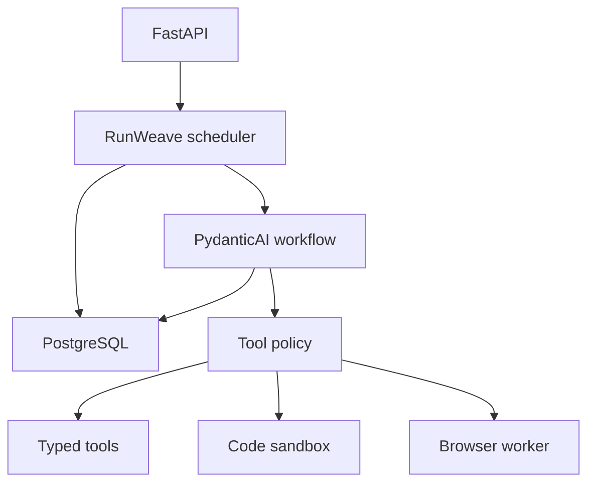

# RunWeave: build plan

Status: milestones 1–6 follow the accepted roadmap from 2026-11-05.
Milestones 7–16 plan the expanded platform requested on 2026-11-14.
Milestones 1 through 6 have code in place. The PostgreSQL recovery check passed
locally. In-process tests and benchmarks run with wakeup sockets disabled in
the Windows sandbox harness. Native socket startup and Docker checks remain open.

## How we will follow this plan
This file is the project's source of truth for implementation order and scope.
Work through the milestones in sequence, starting with milestone 1 when the
user requests implementation. Update the checklist only after each milestone's
completion criteria have been verified, and record material scope changes here.

- [ ] 1. Foundation and contracts
- [ ] 2. Bounded orchestration
- [ ] 3. Recovery and lifecycle
- [ ] 4. Agent behavior and tool safety
- [ ] 5. Observability and reproducible load evidence
- [x] 6. Durable recovery
- [ ] 7. PydanticAI integration and workflow parity
- [ ] 8. Automated agent evaluation and security fixtures
- [ ] 9. Authentication, authorization, and prompt-injection defenses
- [ ] 10. Context, token, and cost budgets
- [ ] 11. Durable workflow checkpoints and replay
- [ ] 12. Human approvals and resumable waiting
- [ ] 13. Scoped persistent memory
- [ ] 14. Typed multi-agent coordination
- [ ] 15. Sandboxed code and authorized browser automation
- [ ] 16. Shadow workflow comparison and release verification

## Goal
A FastAPI service that accepts agent jobs, executes at least 100 simultaneous
I/O-bound runs in a controlled local benchmark, keeps its API responsive, and
handles tool failures, cancellation, overload, and shutdown predictably.

The problem is blocking work and unbounded scheduling, not while True itself.
An async worker can safely loop while awaiting queue.get(). Concurrency overlaps
I/O waits; it does not make CPU-heavy Python work execute in parallel.

## Demonstration workload
Use a developer incident-triage agent: retrieve a synthetic incident, query a
mock service-health endpoint, search local fixture runbooks through an async
tool interface, and return a structured summary with evidence identifiers.
Begin with a deterministic fake model; subsequently use a real model to choose
registered tools and decide when to finish. This separates orchestrator capacity
from provider latency, cost, and rate limits. No production incident data is needed.

## Stack and rationale
| Layer | Choice | Purpose |
| --- | --- | --- |
| Runtime | Python 3.13, asyncio | Native async scheduling and cancellation |
| API | FastAPI, Uvicorn | Typed REST endpoints and OpenAPI |
| Contracts/config | Pydantic v2, pydantic-settings | Validate requests, tools, settings |
| HTTP tools | HTTPX AsyncClient | Shared pooling and bounded network waits |
| Agent | Small explicit execution loop + provider protocol | Visible step limits and tool boundaries |
| Environment | uv, pyproject.toml, uv.lock | Reproducible dependency environment |
| Quality | Ruff, mypy, pytest, pytest-asyncio | Static and behavior checks |
| Telemetry | JSON logs, Prometheus text exposition, OpenTelemetry | Diagnose queueing and tool latency |
| Load driver | Async HTTPX script | Controlled concurrency and reproducible scenarios |
| Packaging | Docker, later Compose | Local repeatable demo |
| Durability, later | PostgreSQL, async SQLAlchemy, Alembic | Persistent jobs, attempts, leases |

Pin tested compatible versions as dependencies are introduced. The expanded
platform uses PydanticAI and Pydantic Graph for agent workflows. Redis, Kafka,
Celery, Kubernetes, and a frontend stay outside this plan until a specific
requirement justifies them.

## Execution design
1. Validate submission, check admission limits, create job ID, enqueue atomically
   from the application's perspective, and respond with 202 plus status URL.
2. A bounded worker pool consumes a bounded asyncio.Queue. Suggested initial
   configuration: 128 active runs and 1,000 queued jobs, all configurable.
3. Each run checks its deadline, obtains a model decision, validates it, executes
   permitted tools asynchronously, records step outcomes, and repeats within
   step/token limits or finishes with a validated result.
4. Provider/tool semaphores limit outstanding calls independently of worker
   count. Provider request/token rate limits apply separately. Initial mock
   limits must allow at least 100 overlapping tool waits for the capacity test.
5. Expected failures become per-job outcomes. Supervisor failures fail readiness.
6. Retain results for a bounded TTL and maximum record count; expired IDs return
   404. Document the retention policy and make its cleanup task supervised.

Admission, cancellation, and completion must have atomic state transitions.
Use short critical sections without network awaits. A queued cancellation can
leave a queue entry that a worker skips; an active cancellation cancels the
tracked task. First terminal transition wins. Queue task_done must be paired
exactly once with every successful get, including cancelled/skipped jobs.

Use one application process in the MVP; multiple Uvicorn workers would each have
separate queues and job registries. Horizontal scaling requires shared state.

## API contracts
| Endpoint | Behavior |
| --- | --- |
| POST /v1/runs | Submit typed agent input; return 202 and run ID/status URL |
| GET /v1/runs/{id} | State, timestamps, result or sanitized error |
| POST /v1/runs/{id}/cancel | Request cancellation; return current state |
| GET /health/live | Process liveness |
| GET /health/ready | Scheduler accepting work and dependencies ready |
| GET /metrics | Prometheus scrape endpoint |

Use 422 for invalid input, 404 for unknown/expired IDs, and 503 with Retry-After
for saturated admission. Queue saturation alone need not fail readiness; doing
so can shift load between replicas instead of applying admission control.
Define error codes and cancellation repeat semantics before implementing routes.

## Failure policy
- A tool timeout can be retried only when classified transient and safe.
- Permanent tool/model errors fail that run with a structured error.
- Apply connect/read/write/pool timeouts plus a wall-clock step deadline.
- Overall timeout includes queue wait and retries; expired queued work never
  starts a model or tool call.
- Shutdown stops admission and readiness, drains for a configured grace period,
  cancels/awaits unfinished tasks, and closes shared resources last.
- In-memory work is lost on a crash. Graceful drain is not crash recovery.
- Side-effect tools need downstream idempotency; orchestrator retry logic alone
  cannot guarantee exactly-once effects.

## Milestones and completion criteria

### 1. Foundation and contracts
Create pyproject, settings, application factory, lifespan, schemas, tool/model
protocols, fake provider, health endpoints, and development instructions.
Done when the app starts/stops cleanly and a typed single fake run completes.

Implementation notes (2026-11-05):
- Added the application factory, lifespan-owned shared HTTP client, validated
  settings and schemas, small model/tool protocols, fake adapters, a single-run
  runner, health endpoints, offline CLI, and developer instructions.
- Applied SOLID through constructor injection and structural protocols, without
  inheritance layers or empty packages for future milestones.
- Added lifecycle, validation, collaborator substitution, and cancellation tests.
- All 11 synchronous validation tests, Ruff lint/format, and strict mypy pass.
  Seven async tests remain unverified. Runtime tests and the demo could not
  finish: the managed Windows environment blocks while the built-in event loop
  creates its local socket pair, before application code executes.
- uv.lock is now present and was checked offline after the RunWeave rename.
  Earlier editable packaging verification encountered a
  sandbox-specific setuptools path expansion error involving braces in a path.
- Before marking this milestone complete, run uv sync --locked,
  run the full README verification commands, and confirm the demo and Uvicorn
  startup/shutdown outside these environment restrictions. Keep the milestone
  unchecked until those checks succeed.

### 2. Bounded orchestration
Implement admission, queue, workers, state registry, polling, cancellation,
retention cleanup, and tracked tasks.
Done when 100+ mock runs overlap, queue overflow is rejected predictably, and
observed active executions never exceed the configured limit.

Implementation notes (2026-11-05):
- Added `/v1/runs` submission, status, and cancellation routes; submission returns
  202 only after successful queue admission, with Location and status_url.
- Added a single-event-loop registry with immutable snapshots, atomic state
  transitions, first-terminal-state-wins behavior, terminal TTL, and history cap.
- Added 128 configurable supervised workers, a 1,000-entry bounded queue, tracked
  execution tasks, sanitized run errors, and a supervised history cleanup task.
- Queue saturation produces 503/Retry-After without failing readiness. Scheduler
  failures fail readiness and propagate through the lifespan TaskGroup.
- Shutdown immediately marks unfinished work CANCELLED, cancels workers, balances
  queue accounting, and awaits execution cleanup before closing the shared client.
  Graceful draining and deadlines remain milestone 3 work.
- Added deterministic async tests for 128 overlapping runs out of 180 submitted,
  saturation, queued/running cancellation, late results, failed-run isolation,
  task cleanup, supervisor failure, history cleanup, and HTTP contracts.
- All 17 synchronous validation/state tests, Ruff, and strict mypy pass. The native
  Windows asyncio probe still hangs in socketpair creation before app code runs.
  The async suite remains unverified; run the README commands on a normal local
  terminal before checking off this milestone or claiming concurrency evidence.

### 3. Recovery and lifecycle
Add deadlines, classified retries with jitter, cancellation-safe cleanup,
worker supervision, and graceful shutdown.
Done when a failure matrix proves job isolation, no retries after cancellation
or deadline expiry, terminal-state correctness, and bounded shutdown time.

Implementation notes (2026-11-09):
- Runs have a monotonic deadline from admission. Queued work can time out before
  any model or tool call. Each agent step also has a wall-clock limit, and retry
  attempts and delays share both budgets.
- The read-only health tool retries classified transient HTTP and transport errors.
  Backoff uses jitter and honors Retry-After when the wait fits within the delay
  cap and remaining budget.
- Lifespan shutdown stops admission, drains for the configured grace period,
  cancels remaining runs, and awaits worker cleanup before closing the client.
- All 53 tests passed using a temporary socket-free Windows event-loop harness,
  including the earlier 128-run overlap test and the recovery matrix. Ruff,
  strict mypy, and the lockfile check pass. Native event-loop startup still hangs
  in the sandbox, leaving normal pytest and Uvicorn smoke verification open.

### 4. Agent behavior and tool safety
Add the incident-triage workflow, structured model decisions, typed tool registry,
budgets, destination restrictions, and one optional live provider adapter.
Done when a run performs multiple validated model/tool steps and returns an
evidence-backed structured result; fake mode remains fully offline.

Implementation notes (2026-11-09):
- Both models use the same bounded runner loop. It dispatches validated health
  and runbook calls and checks the final result against observed evidence IDs.
- Groq inference is opt-in. It uses the shared HTTP client, a fixed HTTPS
  destination, bounded response reads, a completion-token budget, and separate
  controls for concurrency and request rate. The local `.env` contains a dummy key.
- All 61 tests passed in the socket-free harness, including the mocked Groq
  transcript and rejected unsafe tool calls. Ruff, strict mypy, and the lockfile
  check pass. Native Windows and live Groq verification remain open.

### 5. Observability and reproducible load evidence
Add metrics, traces, JSON logs, mock fault server, load script, Dockerfile,
benchmark report, and a demo README.
Done when another developer can reproduce the concurrency and failure results
with documented commands and no paid model credentials.

Implementation notes (2026-11-13):
- Added Prometheus-compatible `/metrics`, opt-in JSON run logs, and opt-in
  OpenTelemetry console spans. Logs and traces use allowlisted fields. Metrics
  group outcomes and errors without labels derived from incident data.
- Added an offline HTTPX benchmark and deterministic mock health faults. The
  benchmark compares 1, 10, 50, 100, and 128 workers with the same input batch.
- Added a lockfile-based Docker image that runs as a non-root user. The Docker
  daemon was unavailable during verification. See `benchmarks/README.md` for
  the reproduction commands, measured results, and limits of the evidence.
- The sweep reached 128 overlapping runs and tool steps. The ten-minute soak
  completed 76,928 runs and kept terminal history at 128 records. The soak
  missed the event-loop lag target in the sandbox harness. Native benchmarking
  and Docker verification remain open.
- On 2026-11-14, an offline rerun with 100 workers completed all 128 runs and
  reached 100 overlapping runs and tool steps. Status p95 was 3.07 ms across
  15 probes. Event-loop lag p99 fell in the histogram bucket ending at 50 ms,
  which leaves the strict sub-50 ms target unverified. The fault outcomes
  matched the benchmark report. This rerun used the same socket-free harness.

### 6. Durable recovery (separate follow-on)
Persist jobs and attempts in PostgreSQL, define atomic claim/lease/heartbeat
semantics, persist delayed retry scheduling, and reclaim expired leases after
process death. Use the database as the durable source of pending work, avoiding
a database-plus-queue dual-write gap. Multiple workers claim with transactional
locking; retries imply at-least-once execution. Protect side effects with real
idempotency and discard stale completions using lease ownership/fencing.
Done when kill/restart tests show accepted work remains discoverable, expired
leases recover, and competing workers cannot commit stale job results.

Implementation notes (2026-11-13):
- PostgreSQL mode commits admission before HTTP 202. Workers claim rows with
  `FOR UPDATE SKIP LOCKED`. Each attempt has a lease token that fences heartbeat
  and completion writes. Expired leases persist a delayed retry and keep the
  original deadline. The attempt limit bounds recovery after repeated crashes.
- The API supports the same run IDs, status polling, and cancellation in both
  modes. SQLAlchemy and greenlet are in `uv.lock`. The optional PostgreSQL driver
  and migration CLI are pinned in `requirements-durable.txt` because their
  packages could not be resolved in the offline workspace.
- PostgreSQL 18 single-user mode executed the migration and checked admission,
  claim, renewal, completion, delayed recovery, and stale-token rejection.
- `scripts/verify-postgres.ps1` runs the asyncpg integration test against a
  disposable local cluster. The test waits for the exited worker's lease to
  expire, checks that only one competing claimant can recover the run, and
  verifies that the API can read the result and complete a new run. The project
  owner reported a passing run against a disposable local PostgreSQL cluster.

## Expanded platform architecture

Keep the original incident-triage workload as the end-to-end example. Develop
against synthetic incidents and a fake provider, with Groq as the opt-in live
adapter. FastAPI retains admission and run APIs. RunWeave owns scheduling,
cancellation, deadlines, worker leases, authorization, and resource policy.
PydanticAI owns model interactions, typed tool integration, and structured
outputs. Pydantic Graph owns workflow transitions. PostgreSQL is the source of
truth for durable runs, checkpoints, approvals, usage, and scoped memory.
External code and browser sessions run through isolated workers behind typed
tool interfaces. OpenTelemetry spans link runs, attempts, nodes, and tool calls
using identifiers and timing without raw prompts or secrets by default.

Implement in dependency order. Build a parity baseline before adding features,
evaluate it early, and put durable state and policy in place before tool writes.
Add migrations with the features that use them. Pin workflow and prompt versions
for in-flight runs. Define an API compatibility strategy before introducing new
public states or approval endpoints.

### 7. PydanticAI integration and workflow parity

- Pin compatible PydanticAI, Pydantic Graph, and Groq dependencies with uv.
  Integrate through the existing execution boundary so API and scheduling
  contracts stay stable. Reuse the typed incident, evidence, and tool models.
- Build one typed graph for incident triage with explicit evidence collection,
  final validation, and branching on structured outcomes. Wire fake and Groq
  models through the same workflow. Keep the current runner available as the
  parity baseline and later shadow comparator.
- Check Groq structured-output compatibility, HTTP client ownership, request
  timeout behavior, retries, request rate, and concurrency limits with the
  pinned versions. Keep retry ownership explicit to avoid multiplied retries.
- **Done when** the fake and mocked-Groq paths pass the same contract, evidence,
  cancellation, and failure cases as the original runner, with the same API
  behavior. Document one opt-in live Groq smoke command and rerun offline load
  parity.

Implementation notes (2026-11-14):
- Extracted typed triage state and shared step operations from the baseline
  runner. The operations preserve per-step deadlines, completion-token limits,
  tool validation, and final evidence checks for the future graph integration.
- Baseline verification passed in the socket-free harness with 62 tests
  passing and the opt-in PostgreSQL test skipped. The 100-worker offline case
  completed all 128 runs, reached 100 simultaneous runs and tool steps, and
  reproduced the expected fault outcomes.
- Added an opt-in PydanticAI execution path with deferred tool proposals and a
  typed Pydantic Graph. It keeps the existing fake and Groq model adapters and
  uses the baseline step rules. The `workflow` extra pins both framework
  packages in `uv.lock`.
- The framework-enabled suite reported 66 passes with the opt-in PostgreSQL
  test skipped. The PydanticAI cases verified API completion, step timeout
  reporting, and the mocked Groq transcript.
- The project owner reported a native Windows run with 128 successes, 100
  overlapping runs and tool steps, 111.92 runs/s, and 2.38 ms status p95.
  That report predates the workflow identifier in benchmark output.
- An explicitly tagged PydanticAI run in the socket-free harness matched
  concurrency and fault outcomes. It completed all 128 runs at 9.00 runs/s
  with 15.68 ms status p95 and a 1,000 ms upper bucket for event-loop lag p99.
- The project owner then ran both workflow variants with native Windows
  asyncio, 100 workers, and 128 synthetic runs per variant. Both completed all
  runs, reached 100 overlapping runs and tools, and matched the expected
  fault outcomes. The comparison reproduced a throughput and completion
  latency regression. Functional parity passed and performance parity
  remains open.

  | Native metric | Baseline | PydanticAI |
  | --- | ---: | ---: |
  | Throughput (runs/s) | 90.04 | 18.74 |
  | Completion p95 (ms) | 926.30 | 4,672.31 |
  | Queue wait p95 (ms) | 491.74 | 3,442.79 |
  | Status API p95 (ms) | 6.33 | 2.72 |
  | Event-loop lag p99 bucket upper bound (ms) | 100 | 500 |
  | Peak RSS (MiB) | 75.65 | 112.89 |

### 8. Automated agent evaluation and security fixtures

- Use versioned synthetic datasets and Pydantic Evals for expected evidence,
  severity, tool choice, unsupported claims, malformed results, and attacks
  embedded in incident or tool content. Record workflow, prompt, model, fixture,
  and evaluator versions. Keep deterministic checks separate from optional
  live quality scoring.
- **Done when** CI can reproduce an offline report and fails on a seeded
  regression. Establish a quality baseline and a small human-reviewed fixture
  set before defining thresholds for subjective scores. Paid judges are opt-in.

### 9. Authentication, authorization, and prompt-injection defenses

- Define a principal with tenant, subject, and scopes. Enforce run ownership
  on reads, submissions, cancellations, and future approval endpoints. Use a
  test identity provider locally and verify signed tokens against an issuer for
  authenticated deployments. Enforce tenant admission limits and audit decisions.
- Treat model proposals, incident content, retrieved memory, and tool outputs as
  untrusted. Put allowlists, typed argument validation, scope checks, egress
  rules, and redaction at execution boundaries. A prompt or model response
  cannot grant permissions. Preserve restricted defaults across every tool.
- **Done when** cross-tenant access tests fail closed and injection fixtures
  cannot trigger unauthorized operations or leak test secrets through tool calls,
  outputs, or telemetry. Extend the same tests as new capabilities arrive.

### 10. Context, token, and cost budgets

- Budget requests, input and output tokens, and estimated spend across the
  entire run, including retries, resumed work, and delegated work. Preflight
  context with the pinned model's tokenizer when available or a documented
  conservative estimate. Use versioned prices, reserve budget before dispatch,
  reconcile against provider usage, and conservatively account for lost responses.
- Bound tool evidence and memory injected into context. Compact older messages
  deterministically first, preserving instructions, evidence references, and
  pending tool-call pairs. Record budget decisions and usage without prompt text.
- **Done when** oversized contexts and insufficient budgets fail before a
  provider call, parallel work cannot overspend the shared reservation, and
  retries or failures preserve accounting. Report spend as an estimate and
  document how missing provider usage affects the ledger.

### 11. Durable workflow checkpoints and replay

- Persist typed, versioned workflow state and the next node at explicit
  boundaries, including committed evidence and usage. Start with RunWeave's
  existing PostgreSQL lease scheduler as execution owner. At this milestone,
  evaluate a supported PydanticAI durability integration if replay requirements
  warrant it. If adopted, document a single owner for scheduling and replay
  before switching.
- Commit checkpoint updates with lease fencing and a monotonic sequence. Store
  stable operation identities for external effects. Reuse committed results,
  reconcile ambiguous writes by idempotency key, and require manual resolution
  when the downstream cannot confirm the outcome. A crash around inference
  can cause duplicate calls and cost even when committed steps replay safely.
- **Done when** worker-kill tests resume at the next committed node, retain
  budgets, reject stale writes, and cover a crash both before and after an
  effect commit. Validate resume across deployments for supported versions and
  define a safe outcome for an unsupported checkpoint version.

### 12. Human approvals and resumable waiting

- Use PydanticAI deferred tools for one concrete gated action, such as creating
  a ticket in a sandbox. Persist the request and its exact arguments, release
  the worker lease during the wait, and resume from the saved checkpoint after an
  authorized decision. Bind the decision to tenant, run, tool-call ID, argument
  digest, policy version, and expiry. Recheck authorization at execution.
- Add waiting, approval, rejection, expiry, and cancellation semantics. Track
  approval waiting separately from active execution budget, with a hard expiry
  and bounded pending approvals. Make decisions idempotent and auditable.
- **Done when** approval survives restart, only approved arguments can execute,
  duplicate and concurrent decisions are safe, and denial, expiry, cancellation,
  or revoked permissions prevent the effect.

### 13. Scoped persistent memory

- Store typed, provenance-linked facts with tenant and subject/project scope,
  retention, deletion, and explicit write policy. Use bounded PostgreSQL
  retrieval first and add semantic retrieval only if evaluation demonstrates a
  need. Treat recalled facts as data and apply the context budget to each recall.
- **Done when** a later run can recall an allowed fact after restart, expired
  or deleted facts stay out of prompts, cross-scope retrieval fails closed, and
  adversarial memory entries cannot change instructions or tool permissions.

### 14. Typed multi-agent coordination

- Introduce a coordinator and two bounded specialists for health analysis and
  runbook analysis. Define typed handoff requests, outputs, failure outcomes,
  and merge policy. Run independent work concurrently when budget permits.
  Propagate cancellation, deadlines, trace context, and the parent's budget.
- Checkpoint and correlate each branch so restart reuses committed work. Give each
  specialist only the scopes and tools it needs. Keep final evidence validation
  at the coordinator and prohibit unbounded delegation.
- **Done when** contract and evaluation tests cover successful handoffs, partial
  failure, cancellation, budget exhaustion, replay, and denial of unauthorized
  delegation. Compare quality and cost with the single-agent baseline.

### 15. Sandboxed code and authorized browser automation

- Deliver as two reviewable slices. First run a narrowly scoped Python tool in
  a separate, disposable sandbox with no host mounts, credentials, or default
  network access. Enforce wall-clock, CPU, memory, process, file, and output
  limits. Verify isolation on the target runtime before enabling the tool.
- Then add a Playwright browser worker with per-run isolated sessions. Start
  with read-only access to approved test origins. Enforce egress for navigation,
  redirects, and subresources outside model control. Pass credentials through
  a scoped broker. Gate writes with approval and idempotency or reconciliation.
- **Done when** tests cover isolation, path escapes, resource exhaustion,
  network denial, cross-session leakage, malicious pages, redirect and
  subresource blocking, and cleanup after timeout or cancellation. Demonstrate
  both tools on controlled fixtures. Disable them until their policy is configured.

### 16. Shadow workflow comparison and release verification

- Compare a pinned primary workflow with a candidate on the same authorized,
  sanitized input and initial state. Run candidates in a separate budget and
  queue with effect tools disabled or simulated. Only the primary can affect
  the user's result, persistent memory, or external systems.
- Report paired differences in evidence, outcome, latency, tokens, estimated
  cost, and safety. Define promotion thresholds on the evaluation baseline and
  keep explicit promotion and rollback controls.
- Document architecture, workflow state and failure semantics, deployment and
  migration commands, threat model, test fixtures, load/eval reproduction, and
  operations runbooks. Close outstanding native and container checks. Rerun
  concurrency, fault, security, recovery, soak, and approval scenarios with
  recorded configuration and results. Keep the existing strict loop-lag target
  visible until it is measured or explicitly revised with evidence.
- **Done when** a new developer can reproduce the offline demo, evaluation,
  recovery, and shadow report from a clean checkout. The final demo shows a
  durable workflow with typed delegation, scoped recall, a worker restart,
  approval of a controlled action, trace and budget reporting, and a side-by-side
  candidate result with no external effects. Run the sandbox and browser checks
  independently. Keep live inference opt-in and apply the public deployment
  gate before exposing the service.

### PydanticAI references

- [Groq provider](https://pydantic.dev/docs/ai/models/groq/)
- [Pydantic Graph builder](https://pydantic.dev/docs/ai/graph/builder/)
- [Deferred tools](https://pydantic.dev/docs/ai/tools-toolsets/deferred-tools/)
- [Durable execution integrations](https://pydantic.dev/docs/ai/capabilities/durable_execution/overview/)
- [Multi-agent patterns](https://pydantic.dev/docs/ai/guides/multi-agent-applications/)
- [Pydantic Evals](https://pydantic.dev/docs/ai/evals/evals/)

## Benchmark acceptance plan
These are initial targets to validate, not performance claims.
- Controlled workload: one fake model decision, two async 200 ms mock tool
  calls, then a fake final response; no external network or paid model traffic.
- Test active-run limits of 1, 10, 50, 100, and 128 with the same total workload.
- Sustain at least 100 overlapping active runs and separately observe tool-call
  overlap. Record the worker and connection limits used.
- Initial local targets: status API p95 below 100 ms and event-loop lag p99
  below 50 ms under the 100-run mock scenario; revise with recorded evidence.
- Inject fixed-seed 429, transient 5xx, permanent 4xx, slow responses, malformed
  model decisions, disconnects, cancellation, and termination during execution.
- Assert correctness separately from speed: concurrency bounds, bounded queue
  and retained records, expected outcomes, and absence of orphaned tasks.
- Run a bounded 10-minute soak and record memory trend and history eviction.
- Report hardware/OS, process count, concurrency, request count, duration,
  throughput, p50/p95/p99 completion and queue latency, API latency, event-loop
  lag, RSS, retries, errors, timeouts, and cancellations.
- Keep live provider smoke results separate: provider quotas can cap real-world
  concurrency well below the orchestrator's mocked capacity.

## Proposed layout
- src/runweave/api/: routes and request/response models
- src/runweave/core/: settings, lifespan, dependency wiring
- src/runweave/orchestration/: scheduler, state, retry policy
- src/runweave/agents/: runner, provider protocol, fake/live adapters
- src/runweave/tools/: contracts, registry, tool implementations
- src/runweave/storage/: memory repository; later SQL repository
- src/runweave/telemetry/: logs, metrics, tracing
- tests/: unit and integration behavior tests
- benchmarks/: mock server, load runner, measured reports
- docs/: architecture decisions and demo walkthrough

## Public deployment gate
Local-only development comes first. Before public exposure add authentication,
per-user admission/rate limits, secret handling, payload/response limits, outbound
destination controls, and deployment-specific operational configuration. Docker
packaging alone does not make this a production service.

## References
- https://docs.python.org/3.13/library/asyncio-task.html
- https://docs.python.org/3.13/library/asyncio-queue.html
- https://fastapi.tiangolo.com/advanced/events/
- https://fastapi.tiangolo.com/deployment/concepts/
- https://www.python-httpx.org/async/
- https://www.python-httpx.org/advanced/timeouts/
- https://www.python-httpx.org/advanced/resource-limits/
