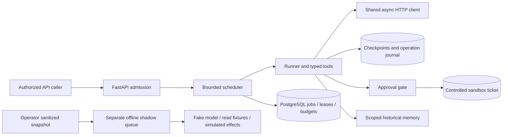

# Architecture, trust boundaries and operations

RunWeave is a backend orchestration service. The default incident workflow uses a
fake model and two fixed read tools. Baseline, PydanticAI and coordinated workflows
share authorization, content checks and budget semantics. Coordinated runs use
typed health/runbook handoffs with bounded parallelism; RunWeave owns scheduling,
checkpoint persistence and replay for every workflow.



API, scheduler, runner, tools, storage and telemetry are separate modules. Shared
clients and supervised tasks are lifespan-owned. The in-memory backend uses one
Uvicorn process; replicas have independent queues/history and lose work on crash.
The durable backend commits admission in PostgreSQL before returning HTTP 202,
then claims rows with leases, fenced writes and transactional locking. Database
polling replaces a second message queue and avoids dual-write admission gaps.

## State and failure semantics

Normal transitions are `QUEUED -> RUNNING -> SUCCEEDED/FAILED/TIMED_OUT/CANCELLED`.
Terminal states cannot be overwritten. An overall deadline includes queue wait,
model/tool steps, retries and backoff. Queue saturation returns 503 with
Retry-After, tenant unfinished-work quotas return 429, and malformed input returns
422. Expected per-job failures stay isolated; supervisor/storage failures stop
admissions and make readiness fail. Liveness alone does not promise dependencies
are healthy.

Durable runs can move from RUNNING to WAITING_APPROVAL and back to QUEUED following
approval. Waiting releases the worker lease and persists the exact proposal,
argument digest, owner, policy and expiry. Approval/cancellation races serialize
with the effect transaction. Expired leases allow bounded retries; a stale claim
cannot commit. Completed read checkpoints can be reused. This is at-least-once
execution, not a guarantee of exactly-once external effects. The local ticket
adapter atomically binds its receipt and approval in PostgreSQL; a real adapter
must provide downstream idempotency or reconciliation. Ambiguous side effects
must remain unresolved rather than being blindly retried.

Memory is optional, historical and untrusted. Recall rechecks identity, service,
project membership, deletion and expiry; it never grants authority or replaces
current observations. Writes derive only from authorized completed-run evidence.
Budgets survive durable retries and approvals. Missing token usage is charged
conservatively; price versions and estimates must not be described as billing.

See [checkpoints](checkpoints.md), [approvals](approvals.md), [memory](memory.md),
[budgets](budgets.md), [coordination](coordination.md) and [security](security.md)
for schemas, migration behavior and detailed API contracts.

## Threat model

| Boundary | Enforcement and limitation |
| --- | --- |
| Caller identity | JWT/test/local modes, scoped permissions, tenant/subject ownership and bounded unfinished work. Local mode is development-only. |
| Model output and retrieved content | Typed allowlisted tools, exact incident-service binding, validated evidence, protected-content rejection. Prompts/pages/memory cannot grant scopes. Offline attack fixtures do not prove live-model resistance. |
| Outbound HTTP | Fixed tool/provider destinations, redirects disabled, bounded responses and shared async transport. No unrestricted URL tool. |
| Durable state | Lease tokens, compare-and-swap checkpoints and owner-bound approvals. PostgreSQL and its administrators remain trusted. |
| Python/browser execution | Disposable constrained containers, non-root/no capabilities/read-only roots/no network/no host mounts. Target-runtime startup probes fail closed. Containers share a kernel; controller Docker authority remains trusted. |
| Shadow execution | Authorized immutable private snapshots, fresh contexts, separate budgets/queue, fixed offline factories, simulated tickets, no database or external-effect handles. No live traffic interception. |
| Telemetry | Allowlisted fields and static error responses; incident text, credentials and sensitive arguments must not be logged. Operator-controlled traces/reports still require appropriate access controls. |

The approved browser origin is a controlled synthetic fixture. Browser writes,
arbitrary Internet browsing, general filesystem/shell tools and subscription-account
integration are outside this release. Do not expose the Docker socket to an
untrusted app or make sandbox policy editable by a model.

## Local deployment and migrations

```powershell
uv sync --locked --extra workflow --extra eval
uv pip install -r requirements-durable.txt
$env:RUNWEAVE_MODEL_PROVIDER = 'fake'
# Set RUNWEAVE_DATABASE_URL securely to your authorized PostgreSQL database.
uv run --no-sync alembic upgrade head
uv run --no-sync alembic current
uv run --no-sync uvicorn runweave.app:create_app --factory --host 127.0.0.1 --port 8000 --workers 1
```

The current migration head is `0007_generic_agents`. Test migrations on a backup
copy, stop old workers before upgrading, and run the same code/policy/auth settings
on all durable workers. The release helper applies the SQL chain in a disposable
schema; it does not migrate a developer's existing database. Legacy migration,
checkpoint and approval tests exercise compatibility and crash recovery.

For image verification, `docker build -t runweave-release:m16 .` followed by
`scripts/check-container.py` uses a loopback-only port and a disposable container.
The base image is the minimal default API, not a durable/migration or sandbox
controller image. Build/operate those roles separately with the documented
dependencies; never solve container access by mounting the host Docker socket
into a publicly exposed service.

## Operations and rollback

- Check `/health/ready`, queue depth, active runs, outcome/error counters, retry
  counts, budget exhaustion and event-loop lag. Saturation should cause admission
  backpressure, not automated replay or unbounded worker increases.
- On shutdown, stop admission, fail readiness, drain for the configured grace,
  then cancel and await remaining work before closing clients/storage. Durable
  interrupted attempts are recoverable after lease expiry. In-memory work is lost.
- If PostgreSQL is unavailable, restore connectivity and verify leases/attempts
  before restarting workers. Do not edit lease tokens or force terminal results.
- For an ambiguous effect, reconcile its downstream receipt with the saved stable
  operation identity. Do not delete the journal, approve changed arguments or
  retry an irreversible effect simply to clear an error.
- For a sandbox cleanup failure, leave tools unavailable and readiness failed.
  Inspect containers by their ownership label, restore Docker availability and
  confirm removal before restarting. Do not delete unrelated containers.
- Before changing the active workflow, resolve/drain pending jobs and approvals,
  retain the prior code artifact and use the checked release selection. Incompatible
  queued checkpoints must keep their matching old runner. Rollback restores code
  and workflow selection; it does not undo committed effects or data migrations.
  Unsupported Alembic downgrades fail explicitly. Restore an authorized backup
  when schema rollback is required.

## Public deployment gate

This release is verified for local development. Before public exposure, configure
real authentication, per-user rate limits in an ingress layer, tenant admission
quotas, TLS, secret storage, request/response limits, outbound destination policy,
restricted telemetry/metrics access, database backup/recovery and deployment-specific
resource limits. Review the threat model for actual users and tools. Local auth,
an exposed Docker port, or a successful mock benchmark does not satisfy this gate.
Live inference requires separate opt-in, credentials, configured prices and a
documented budget. No release check spends on a provider.
